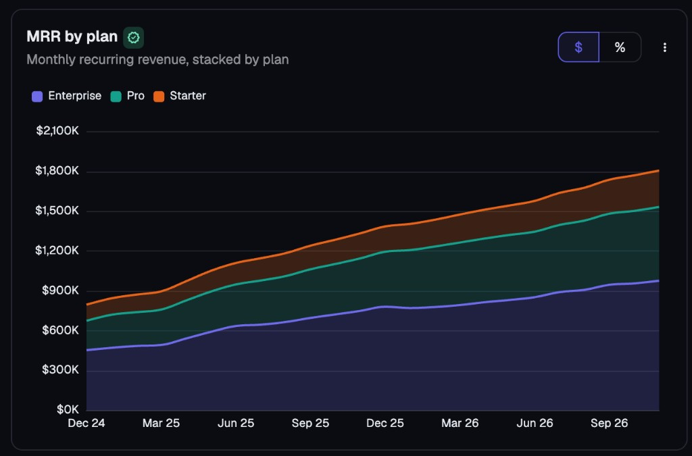

# `st.card` layout container

## Summary

Add `st.card`, a titled panel for dashboards. A card has a header with slots for status
chips and controls, a body for any elements, and an optional footer for data status.
Cards fill the height of their row by default, so side-by-side cards line up.

```python
with st.card("MRR by plan", caption="Monthly recurring revenue") as card:
    view = card.actions.segmented_control(
        "View", ["$", "%"], default="$", label_visibility="collapsed"
    )
    card.footer.caption("Refreshed hourly")
    st.area_chart(mrr if view == "$" else mrr_share)
```

## Problem

Dashboards are built from panels: a chart or table with a short title, a line of context,
and a few controls on the right of the title row. Streamlit apps build each panel by hand.
The [BI dashboard demo](https://github.com/streamlit/demos/tree/main/bi-dashboard) uses
this helper for every panel:

```python
def card_header(title, caption=None, *, help=None):
    with st.container(horizontal=True, vertical_alignment="center", gap="small"):
        with st.container(gap=None):
            st.markdown(f"**{title}**", help=help)
            if caption:
                st.caption(caption)
        controls = st.container(
            horizontal=True, horizontal_alignment="right", width="content"
        )
    return controls


with st.container(border=True, height="stretch"):
    controls = card_header("MRR by plan", "Monthly recurring revenue in $K")
    view = controls.segmented_control(
        "View", ["$", "%"], default="$", label_visibility="collapsed"
    )
    st.area_chart(mrr if view == "$" else mrr_share)
```



The helper works, but:

- Every panel needs three nested containers and `height="stretch"`, or a row of panels
  ends up with uneven heights.
- Nothing keeps headers consistent. Long titles wrap, captions push charts down unevenly,
  and a control makes the title row taller than the label.
- Chart and dataframe hover toolbars cover controls placed above them. In the demo, a
  dataframe toolbar covered a "Show closed" toggle, so the toggle had to move left.
- The panel has no name for assistive technology or the agent API.
- Loading is hand-built: slow cards are wrapped in `st.skeleton(height=...)` with a height
  kept in sync by hand, and some apps hide the title too.
- Data status ("Refreshed hourly", source, owner) has no place that lines up across a row.
- The filled "cards on a tinted canvas" look needs custom CSS on private selectors.

### User requests

- [#16379](https://github.com/streamlit/streamlit/issues/16379): an `st.card` container
  with a title, help, and any body content.
- [#12418](https://github.com/streamlit/streamlit/issues/12418),
  [#10531](https://github.com/streamlit/streamlit/issues/10531): filled cards on a tinted
  page. [#12301](https://github.com/streamlit/streamlit/issues/12301) asks for shadows;
  those are a follow-up.
- [#12322](https://github.com/streamlit/streamlit/issues/12322),
  [#9370](https://github.com/streamlit/streamlit/issues/9370): actions on `st.metric`,
  which should look like card actions.
- Building the BI dashboard demo with an earlier draft: 5 of 13 panels needed title-row
  controls. Hand-built dashboards put up to eight controls in the title row, plus status
  chips such as "Certified" or "Public" next to the title.

### Use cases

1. **Chart panels** with a time range or view switch in the header.
2. **Table panels** with a filter badge, a toggle, or a row count.
3. **Detail panels** with a status chip or favorite beside the title.

Galleries and entity cards still work by composing `st.image` and text in the body, but
this design does not optimize for them.

### Goals

- A titled dashboard panel in one call, without CSS or a helper.
- Consistent headers across cards and widths, and equal heights in a row by default.
- Regular Streamlit elements for header controls and footer status.
- The header visible immediately, with one loading indicator for the body.

### Non-goals

- A styling API (custom colors, shadows, outline styles). Theming is a follow-up.
- Clickable, selectable, or collapsible cards.
- Replacing `st.metric` for KPI tiles.
- Compact widget density in the header and footer. Controls use the standard widget
  height (`2.5rem`). Tighter padding is a [follow-up](#compatible-follow-ups).
- A rerun scope on the card. Widgets in a card rerun what they were created in, as in any
  container; `@st.fragment` limits reruns.
- Card-specific options that existing elements cover: source text, empty states, "More"
  menus, and auto-refresh.

## Proposal

### API

```python
st.card(
    label: str,
    *,
    icon: str | None = None,
    caption: str | None = None,
    help: str | None = None,
    key: Key | None = None,
    border: bool = True,
    background: bool = False,
    width: "stretch" | "content" | int = "stretch",
    height: "stretch" | "content" | int = "stretch",
) -> CardContainer
```

`label` is the only positional parameter. `None` raises
`StreamlitMissingRequiredParameterError`, as in `st.expander`. An empty string logs the
standard label accessibility warning. An empty or whitespace-only `caption` or `help`
counts as not set. For an untitled bordered group, use `st.container(border=True)`.

| Parameter | Behavior |
| --- | --- |
| `label`, `icon`, `help`, `key` | Same as `st.expander`. `icon` may be an emoji, a Material icon, or `"spinner"`. |
| `caption` | Short line under the label. Inline Markdown, like other labels. |
| `border`, `background` | Choose the surface. See [Surface](#surface). |
| `width`, `height` | Same values as `st.container`, except `height` defaults to `"stretch"`. |

The card is the body, so `with card:` and `card.line_chart(...)` write to it. `with`
returns the card:

```python
with st.card("Revenue", caption="Last 12 months") as card:
    card.actions.badge("Live", color="green")
    st.line_chart(revenue)

revenue_card = st.card("Revenue")
revenue_card.line_chart(revenue)
```

It has three slots. Each always refers to the same container. Unused slots take no space.
Slot positions are stable across reruns, so a chart in the body isn't remounted when a
slot is written or skipped.

| Slot | Holds |
| --- | --- |
| `card.header_extras` | Status chips and small items right after the label |
| `card.actions` | Controls on the right of the title row |
| `card.footer` | Data status pinned to the bottom |

A card with an empty body renders only its header (and footer, if used), without an empty
padded body. A skeleton or other pending body content counts as content, so the body
keeps its space while data loads.

### Header

```
[icon] [label] [help] [header_extras]          [actions]
                [caption]
```

The header must work in a card about `12.5rem` wide (200 pixels at the default font
size), the default minimum column width of `st.grid`. At that width, actions wider than
an icon button usually move to their own row.

- **Label:** one line, ending in an ellipsis. The icon and help icon stay visible. The
  label is the card's accessible name. It uses the body font at semibold weight. It is
  not a heading, so it has no anchor and is not part of the page's heading outline.
- **Caption:** up to two lines in the `st.caption` style, then an ellipsis.
- **`header_extras`:** `st.badge`, icon buttons such as a favorite, and short inline
  text. Not for body-changing controls (use `actions`) or a second row of details (use
  `caption` or the body). An empty extras slot takes no width.
- **`actions`:** a horizontal, right-aligned, content-width slot for buttons, menus,
  popovers, segmented controls, pills, and toggles. Card filters go in an `st.popover`.
  Widgets use `label_visibility="collapsed"`. Other elements are allowed but can break
  the layout. If they don't fit on one row, they wrap inside the actions area. An empty
  `card.actions` takes no width and adds no row.
- **Height:** at least one standard widget height (`2.5rem`), so a button or segmented
  control beside the label does not make the header taller. A control taller than the
  label extends down beside the caption instead of pushing the caption down.
- **Hover toolbars** from body elements don't cover either slot.
- **Write order:** slots can be filled before or after the body, for example a row count
  after the data loads.

When the row is too narrow:

1. The label truncates, down to a minimum width (about `8rem`; the final value comes
   from design).
2. `header_extras` wrap under the caption.
3. `actions` move to their own row under the caption.

A truncated label or caption shows its full text the same way as
[`wrap=False` labels](../2026-07-23-horizontal-wrap-control/product-spec.md#tooltip-for-the-full-label):
a native `title` tooltip of the plain text, only when the text is clipped, alongside
`help` because the help icon is a separate target. The tooltip does not apply on touch.
When printing, the label and caption wrap instead of ending in an ellipsis, as
`st.metric` does.

The docstring recommends labels of about 30 characters or fewer. Captions should hold
units, the time window, or one short hint. Longer explanations belong in `help` or the
body. Cards in a row line up when they use the same header fields.

Focus order is label and help, `header_extras`, actions, body, footer.

```python
with st.card("gtmhub", caption="go/gtmhub · 289 clicks") as card:
    card.header_extras.badge("Public", icon=":material/public:", color="green")
    card.header_extras.button(
        ":material/favorite_border:", type="tertiary", help="Add to favorites"
    )
    card.actions.link_button("Visit", url, icon=":material/open_in_new:")
```

The same placement and truncation apply to the single `action` proposed for `st.metric`
in #13212. A metric is a leaf, so it takes one parameter instead of a slot. A KPI that
needs more, such as a menu, puts the metric in a card:

```python
kpi = st.card("ARR")
kpi.actions.menu_button("Actions", ["Export", "Open report"], type="tertiary")
kpi.metric("ARR", "$4.2M", "+8%", label_visibility="collapsed")
```

### Footer

`card.footer` is a row at the bottom of the card, such as `st.caption`, `st.badge`, and
`st.link_button`. It has caption styling and no divider.

- In a card with a set height, the body fills the space above the footer, so footers in a
  row line up.
- A card without a footer has no footer space. Cards in a row line up when they use the
  same slots, so put a source line on every card or none.
- To keep the footer's space while data loads, write a placeholder first:

```python
with st.card("Upcoming renewals", caption="Next 90 days") as card:
    footer = card.footer.empty()
    renewals, loaded_at = load_renewals()
    st.dataframe(renewals, height="stretch")
    footer.caption(f"{len(renewals)} accounts · Updated {loaded_at:%H:%M}")
```

### Loading

The header and footer show as soon as they're written. The body shows an `st.skeleton`
until its first element arrives. That's the only loading indicator: no spinner in the
header, and the card's `icon` never changes unless the author set it.

- **First load:** the skeleton appears after 0.5s, so fast or cached cards don't flash.
- **Reruns:** the previous body stays visible. If the rerun takes longer than 0.5s, the
  skeleton covers it.
- **Height:** the skeleton fills the body when the card's height is set by a grid
  `row_height`, an integer `height`, or a fixed-height parent. Otherwise it uses the
  default skeleton height. An explicit `st.skeleton(height=...)` in the body wins.
- **Errors:** an exception replaces the skeleton. The header stays, so it's clear which
  card failed. Failures stay inside the card ($44).

Fragment reruns that don't re-enter the card aren't covered by this skeleton. That's a
[follow-up](#compatible-follow-ups). Until then, wrap slow fragment bodies in
`st.skeleton` as today.

### Surface

By default, a card has an outline in the theme's border color, with the standard corner
radius and padding of `st.container(border=True)` and `st.metric(border=True)`. From
`st.expander` it takes only the icon placement: no chevron, hover state, or pointer
cursor. Exact spacing is finalized in the design system.

| `border` | `background` | Result |
| --- | --- | --- |
| `True` (default) | `False` (default) | Outlined card |
| `True` | `True` | Filled card with an outline |
| `False` | `True` | Filled card without an outline, the look requested in #12418 |
| `False` | `False` | Titled section with no frame and no padding, like `st.form(border=False)`, for use inside something already framed |

The docstring recommends `border=False` for cards inside `st.grid(border=True)` or nested
inside another card, which would otherwise show a double frame.

`background=True` uses the theme-aware color swap from the
[container background spec (#14683)](https://github.com/streamlit/streamlit/pull/14683),
the same technique as the sidebar:

- The card uses the secondary background of its immediate theme context.
- Children that normally use the background use the secondary background, and the reverse.
- Nested filled cards swap again.
- In the sidebar, the swap uses the sidebar's theme colors.

White cards on a gray page come from theme options:

```toml
[theme]
backgroundColor = "#f0f2f6"
secondaryBackgroundColor = "#ffffff"
```

`border` and `background` are booleans. A single color value wouldn't work in both light
and dark mode, so per-card colors come with scoped themes, a follow-up. Third-party
components that don't use Streamlit's theme may not adapt.

### Sizing

| Where the card is | What sets its height |
| --- | --- |
| `st.grid(..., row_height=<int>)` | The row. Recommended for chart dashboards. |
| `st.columns` | The tallest card in the row |
| Integer `height` | That value. The header and footer stay pinned and the body scrolls. |
| Main flow, sidebar, tabs, or `height="content"` | The content |

`height="stretch"` follows the `st.container` contract: the card is as tall as the larger
of its content and the parent's available height. Stretch never clips or scrolls content.
`width="content"` sizes to the header and body, up to the parent width.

In a grid, `grid.card(...)` is one cell and `grid.cell(column_span=2).card(...)` is a wide
card. For a wide card to match neighbors in a content-height row, `grid.cell()` must fill
the row the way direct grid children do ([#17891](https://github.com/streamlit/streamlit/pull/17891)).
Body charts and dataframes with `height="stretch"` fill the card.

### Other behavior

- **Placement:** works in the sidebar, dialogs, tabs, expanders, popovers, forms, and
  cached functions. In forms, use `st.form_submit_button` instead of `st.button`. Nested
  cards are allowed; use `border=False` on the inner card if both would otherwise draw a
  frame.
- **State:** the card is not a widget. Widgets in slots keep their own identity, keys,
  and values ($40).
- **Accessibility:** the card is a group named by the plain text of its label and
  described by the plain text of its caption, without Markdown syntax or icon shortcodes.
  It isn't a heading, a landmark, or itself focusable. The body is marked busy while it
  loads. Decorative skeletons stay out of the accessibility tree ($49).
- **AppTest and agent API:** `at.card[0]` exposes `header_extras`, `actions`, and
  `footer` as blocks. The agent API reports the label, caption, help, and slots ($54).
- **Cost:** apps that don't call `st.card` pay nothing ($52).

### Examples

Dashboard row:

```python
grid = st.grid(3, row_height=360)
with grid.cell(column_span=2).card("Revenue trend", background=True) as card:
    card.footer.caption("Refreshed hourly")
    st.line_chart(revenue)
with grid.card("Revenue by region", background=True) as card:
    card.footer.caption("Refreshed hourly")
    st.bar_chart(revenue_by_region, horizontal=True)
```

Table with a count after loading (slots can be written after the body):

```python
with st.card("Upcoming renewals", caption="Next 90 days") as card:
    renewals = load_renewals()
    st.dataframe(renewals, height="stretch")
    card.actions.badge(f"{len(renewals)} accounts", color="gray")
```

## Alternatives considered

- **Extend `st.container`** with a label and slots: every container would carry a header,
  and horizontal containers can't use one. `st.expander` is the precedent for a labeled
  container with its own command.
- **Document the helper:** no new API, but no truncation, toolbar, or accessibility
  contract, and every app rebuilds it.
- **`actions=[...]` parameter:** only covers plain buttons. Most header controls are
  segmented controls, toggles, and menus.
- **Other names for `header_extras`:** `header` and `status` are taken by `st.header` and
  `st.status`. `label_extras` reads like a label setting, as `label_visibility` does.
  `meta` suggests a second row. `suffix` suggests a position.
- **A slot before the label, or a badge in `icon`:** the leading spot belongs to the icon,
  and `icon` means a glyph everywhere else.
- **Card as a fragment** (automatic card-only reruns, `fragment=True`, or an `@st.card`
  decorator like `@st.dialog`): the same widget would rerun differently depending on its
  container. Dialogs need it because a full rerun closes them; cards don't.
- **`footer="..."` string:** can't hold badges or links, or update after the data loads.
- **Header spinner while loading:** two indicators at once, and it replaces the author's
  icon.
- **`height="content"` default:** three cards in one grid row measured 99, 182, and 307
  pixels tall.
- **Wrapping the label instead of truncating:** hides nothing, but header heights drift
  in narrow grid cells. `st.metric` also keeps its label on one line.
- **`label` vs. `title`, and the name `st.card`:** `label` is Streamlit's standard term.
  "Card" is the most familiar name for this pattern, and #16379 asks for it. `st.panel`
  clashes with the HoloViz Panel library, and `st.tile` suggests small squares.

## Compatible follow-ups

Each follow-up is additive, so code written against v1 keeps working.

- **Compact density:** a shorter min-height (about `2rem`) for buttons, segmented
  controls, and pills in `header_extras`, `actions`, and `footer`, so they sit on the
  title line. Widgets in the body stay at `2.5rem`. This is a presentation change, not a
  new parameter; `size="small"` on each widget would repeat on every call for a look that
  only matters in these slots. Shipping it later changes how existing card headers look.
  Metric actions (#13212) should use the same density.
- **Fragments and cards:** writing into a card from a parallel fragment, and covering a
  fragment's reruns with the card's skeleton.
- **Theming:** `st.card(theme=...)` for per-card colors, a shadow option, filled cards as
  a theme default, and adaptive fill in dark mode.
- **Alignment across a grid row:** matching header and footer heights when captions or
  footers differ.
- **Card fullscreen** that keeps the header's controls. Start as opt-in so existing cards
  don't gain a hover button.
- **Header updates:** `card.update(label=..., caption=...)`, like `st.status.update()`.
- **Header image**, **selectable title** (such as "Developers ▾"), and
  **content-shaped skeletons**.
- **Metric actions** ([#13212](https://github.com/streamlit/streamlit/pull/13212)) using
  the same header placement and truncation.

## Design references

- [Grafana panels](https://grafana.com/docs/grafana/latest/panels-visualizations/)
- [Material Design 3 cards](https://m3.material.io/components/cards/overview)
- [Component Gallery card anatomy](https://component.gallery/components/card/)
- [Streamlit design-system exploration](https://www.figma.com/design/svukmRMf0N9yQzdv8f7sgO/Streamlit-Open-Source-design-system?node-id=3924-321050)
- [BI dashboard demo](https://github.com/streamlit/demos/tree/main/bi-dashboard)
- Dashboard background comparison in
  [#12418](https://github.com/streamlit/streamlit/issues/12418)

## Checklist

| Item | ✅ or comment |
| --- | --- |
| Works on SiS, Cloud, etc? | ✅ Uses existing container and skeleton patterns |
| No breaking API changes | ✅ New command |
| No new dependencies | ✅ |
| Metrics collected | ✅ Command usage and which slots are used |
| Any security/legal impact? | ✅ Same Markdown handling as existing labels |
| Any docs changes needed? | ✅ Layout API reference, dashboard examples, and bundled agent guidance |
