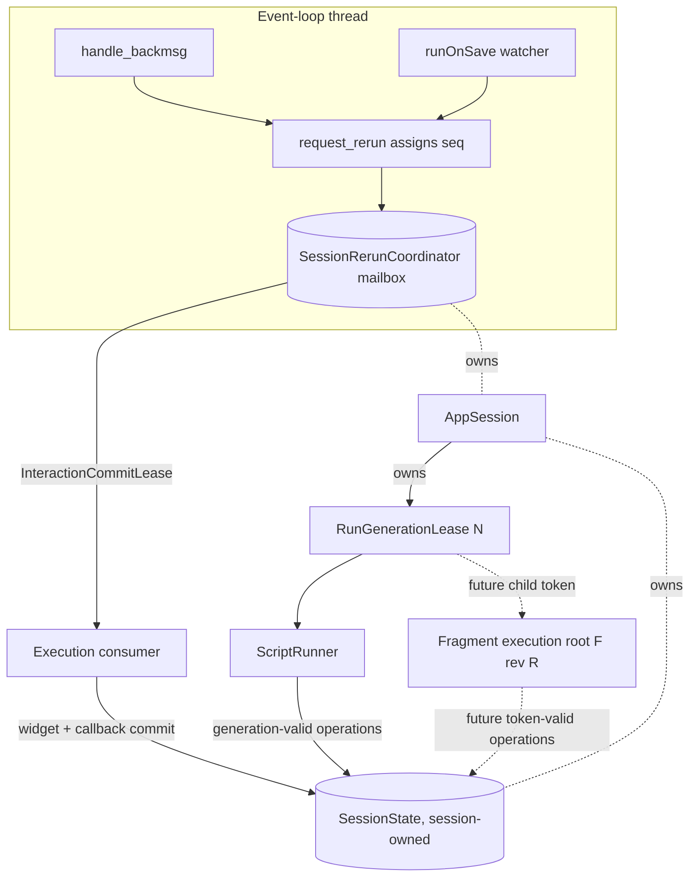

# Session-owned rerun mailbox

## Summary

Rerun coordination currently lives on the `ScriptRunner`, not on the `AppSession`. Under
`runner.fastReruns=true` a full-app interaction stops the running `ScriptRunner` and starts a
fresh one, discarding whatever pending or in-flight interaction state the old runner held, and
the two runners can briefly overlap while sharing one `SessionState`. Callback ordering,
exactly-once callback dispatch, and the final `SessionState` therefore depend on thread timing.

This spec proposes an `AppSession`-owned **rerun mailbox** (a `SessionRerunCoordinator`) that
outlives any single `ScriptRunner`, assigns every accepted browser interaction a session-scoped
sequence position, and hands ordered, coalesced interaction commits to successive execution
consumers. It separates three concepts that later fragment concurrency must compose rather than
overload: a logical run-generation lease, an exclusive interaction-commit lease, and
per-fragment execution tokens. The goal is **session-scoped serial equivalence for interaction
commits** while keeping fast reruns responsive everywhere except a small protected
callback/state boundary.

The mailbox remains an independently shippable foundation. A companion execution-manager design
can later let a fragment interaction replace one root revision while the main full run and
unrelated fragments continue, without discarding the full run or creating another interaction
queue.

## Problem

### Where rerun state lives today

Ownership is split across two layers with different lifetimes:

| Object | Owner | Lifetime |
| --- | --- | --- |
| `SessionState` | `AppSession._session_state` | Whole session; survives runner replacement |
| `ScriptRequests` + pending `RerunData` | `ScriptRunner._requests` | Per runner; **not** transferred on replacement |
| `SafeSessionState` (RLock wrapper) | Per `ScriptRunner`, wrapping the shared `SessionState` | Per runner |
| `_scriptrunner` (the "current" runner) | `AppSession` | At most one; set to `None` during fast-rerun handoff |

`AppSession` owns the durable state (`SessionState`, `_client_state`, `_fragment_storage`), but
the *queue of accepted-but-not-yet-applied interactions* is owned by the ephemeral runner:

```246:248:lib/streamlit/runtime/scriptrunner/script_runner.py
        self._requests = ScriptRequests()
        self._requests.request_rerun(initial_rerun_data)
```

`ScriptRequests` is a thread-safe latch (one pending, coalesced `RerunData`), not a durable
per-session queue:

```179:189:lib/streamlit/runtime/scriptrunner_utils/script_requests.py
class ScriptRequests:
    """An interface for communicating with a ScriptRunner. Thread-safe.

    AppSession makes requests of a ScriptRunner through this class, and
    ScriptRunner handles those requests.
    """
```

### The `fastReruns` interleaving gap

`AppSession.request_rerun` runs on the event-loop thread. For a full-app interaction under
`fastReruns`, it stops the current runner and immediately creates a new one:

```494:516:lib/streamlit/runtime/app_session.py
        if self._scriptrunner is not None:
            if (
                bool(config.get_option("runner.fastReruns"))
                and not rerun_data.fragment_id
            ):
                # If fastReruns is enabled and this is *not* a rerun of a fragment,
                # we don't send rerun requests to our existing ScriptRunner. Instead, we
                # tell it to shut down. We'll then spin up a new ScriptRunner, below, to
                # handle the rerun immediately.
                self._scriptrunner.request_stop()
                self._scriptrunner = None
            else:
                # Either fastReruns is not enabled or this RERUN request is a request to
                # run a fragment. We send our current ScriptRunner a rerun request, and
                # if it's accepted, we're done.
                success = self._scriptrunner.request_rerun(rerun_data)
                if success:
                    return

        # If we are here, then either we have no ScriptRunner, or our
        # current ScriptRunner is shutting down and cannot handle a rerun
        # request - so we'll create and start a new ScriptRunner.
        self._create_scriptrunner(rerun_data)
```

This creates three timing-dependent hazards:

1. **Abandoned interaction state.** Anything the old runner had accepted but not yet applied —
   a pending coalesced `RerunData`, trigger values still queued from a rapid earlier click,
   `st.rerun()` votes gathered mid-callback — lives on the old runner's `ScriptRequests` and is
   dropped. The new runner is seeded only with the newest `RerunData`.
2. **Overlapping runners share one `SessionState`.** The old script thread keeps running until
   its next yield point and can still mutate `SessionState` through `SafeSessionState`, whose
   `RLock` is released between operations, so the old and new runs can interleave writes. The
   wrapper's own docstring calls out that this window exists:

```32:39:lib/streamlit/runtime/state/safe_session_state.py
    """Thread-safe wrapper around SessionState.

    When AppSession gets a re-run request, it can interrupt its existing
    ScriptRunner and spin up a new ScriptRunner to handle the request.
    When this happens, the existing ScriptRunner will continue executing
    its script until it reaches a yield point - but during this time, it
    must not mutate its SessionState.
    """
```

3. **Callback dispatch is not protected across replacement.** If a full-app interaction lands
   while the previous interaction's `on_change`/`on_click` callbacks are mid-flight, the old
   runner is asked to stop while it is still inside `on_script_will_rerun` → `_call_callbacks`
   under the `RLock`. The new runner is created immediately and can begin applying the newer
   interaction's widget states before the earlier callback batch has finished mutating state.

### Recent fixes to single-runner coalescing

[PR #16765](https://github.com/streamlit/streamlit/pull/16765) ("Prevent callback rerun
coalescing races"), a follow-up to #16161, landed the single-runner coalescing fix:

- Replaced `suppress_callbacks` on `RerunData` with `replay_trigger_states` and
  `replay_trigger_values`, decoupling "skip callback dispatch" from "safe to discard in
  coalescing."
- Added `_coalesce_replay_trigger_states` and `_coalesce_replay_trigger_values` to handle replay
  triggers independently of fresh widget states.
- Added `request_rerun_batch` on `ScriptRequests` to fold an ordered batch of callback-generated
  reruns under one lock, preventing fresh interactions from observing a partial batch.

These changes close the single-runner coalescing race documented in #16161. The remaining open
problem is exclusively the **cross-runner** gap: when `fastReruns` replaces a runner, the new
runner's `ScriptRequests` starts empty, any pending coalesced state on the old runner is
abandoned, and two runners can briefly interleave writes to the shared `SessionState`. The
mailbox proposed below addresses that cross-runner gap.

## Goals

- Define and enforce **session-scoped serial equivalence for interaction commits** (below) as a
  single, testable invariant that holds across `ScriptRunner` replacement and future fragment
  execution scheduling.
- Preserve fast-rerun responsiveness everywhere except the minimum callback/state boundary that
  correctness requires.
- Give the coordination a durable, session-scoped home so pending interaction state is never
  silently abandoned while the `AppSession` lives.
- Keep interaction ordering independent from fragment graph ownership, lane scheduling, and
  output staleness so those systems can evolve without creating a second interaction queue.
- Leave a compatible lease boundary for session-owned fragment executions that may eventually
  outlive the main `ScriptRunner` thread.
- Be safe under free-threaded CPython (PEP 703), where the GIL no longer serializes compound
  read-modify-write on shared containers.

## Non-goals

- No change to the public `st.*` API.
- No wire-protocol change in the mailbox foundation. Concurrent fragment execution requires a
  later protocol extension for fragment execution tokens and token-attributed lifecycle events.
- No promise of rollback or exactly-once *external* side effects (network calls, DB writes) when
  user code is superseded, the process crashes, or the `AppSession` is destroyed. The guarantee
  covers Streamlit-managed interaction state and authority, not arbitrary Python effects.
- No frontend batching redesign. The existing macrotask coalescing in `WidgetStateManager` and
  the single ordered WebSocket stream are taken as given.
- User callbacks continue to run on script threads. Nothing in this design executes user code on
  the `AppSession` event-loop thread.
- No session-owned fragment execution manager, replaceable per-root task slots, detached
  fragment task lifetime, or parallel rerun scheduler in the mailbox prototype. Those belong in
  a companion design built on this mailbox, the fragment registry/run ledger, and execution
  tokens.

## Behavioral contract

The contract is defined before any data structure so that the mailbox can be validated against
it, and so alternatives can be compared against the same yardstick.

### What "accepted" means and where the sequence position is assigned

A browser interaction is a `rerun_script` `BackMsg` carrying a `ClientState` (widget states,
query string, page hash, optional `fragment_id`, cached-message hashes). `AppSession.request_rerun`
runs on the event-loop thread, applies the fragment-existence and teardown guards, and constructs
a candidate `RerunData`.

```469:490:lib/streamlit/runtime/app_session.py
            if fragment_id and not self._fragment_storage.contains(fragment_id):
                _LOGGER.info(
                    "The fragment with id %s does not exist anymore - "
                    "it might have been removed during a preceding full-app rerun.",
                    fragment_id,
                )
                return
            ...
            rerun_data = RerunData(
                query_string=query_string,
                widget_states=client_state.widget_states,
                page_script_hash=client_state.page_script_hash,
                page_name=client_state.page_name,
                fragment_id=fragment_id or None,
                is_auto_rerun=client_state.is_auto_rerun,
                cached_message_hashes=frozenset(client_state.cached_message_hashes),
                context_info=client_state.context_info,
            )
```

It becomes **accepted** when the coordinator's capacity/coalescing check succeeds and, in the
same lock section, assigns a monotonically increasing, session-scoped integer **sequence number**
`seq`. A rejected
interaction (fragment no longer exists, session is shutting down, or the bounded queue cannot
legally coalesce it) is *not* accepted and consumes no `seq`. Assigning `seq` on the event-loop
thread makes the order well-defined: that thread is single-threaded and is the one place every
browser interaction funnels through.

The fragment-existence check must evolve with the registry refactor. The mailbox foundation can
use today's `FragmentStorage` check. A future execution manager must validate against the latest
committed, currently visible registry namespace, not require the target to have registered in an
in-progress full-run ledger. Once accepted, the interaction remains durable even if scheduling
must wait for graph reconciliation. If the authoritative replacement scope later proves that the
target was omitted or ambiguously reparented, the scheduler can cancel the body execution; it
must not erase the accepted interaction commit or replay an already consumed trigger.

### Canonical order

The canonical order is **`AppSession` acceptance order**: the order in which
`request_rerun` assigns `seq` on the event-loop thread.

- It is *not* the frontend's raw emission order and *not* wall-clock WebSocket delivery order,
  because the frontend coalesces same-macrotask widget changes into one `rerun_script`
  (latest-wins, triggers preserved) before anything reaches the socket. That coalescing happens
  before acceptance and is deliberately outside the guarantee: the browser decides what counts as
  one interaction; the session orders whatever interactions it accepts.
- **The existing ordered WebSocket stream is sufficient** as the transport. There is one socket
  per tab; inbound frames are dispatched in receive order, and `AppSession.handle_backmsg` is
  invoked from the event loop one message at a time. So delivery order == acceptance order for
  messages on a single connection, and no sequence numbers need to travel on the wire. The
  session assigns `seq` locally; the frontend never sees it.
- Frontend-side batching only affects *what* is delivered, never *reordering*: a later macrotask
  can supersede an earlier interaction's widget value before send, but it cannot make interaction
  B arrive before interaction A once both are distinct messages.

### The interaction-commit serial-equivalence invariant

Let the accepted interactions be `I₁, I₂, …` in canonical order. An **interaction commit**
resets spent triggers, installs one interaction's widget snapshot and replay state, dispatches
its callbacks to completion, records callback-generated rerun votes, and marks those callbacks
consumed. The mailbox linearizes these commits in acceptance order.

The invariant at interaction boundaries is:

> **Commit-prefix property.** When `Iₖ` begins callback dispatch, every prior interaction commit
> `I₁ … Iₖ₋₁` is complete, no part of `Iₖ₊₁` has been installed, and `Iₖ`'s fresh widget values
> are visible. `Iₖ`'s callback mutations become visible before any later interaction commit.
>
> **Drainage property.** Once no accepted interaction is pending or being committed, every
> accepted interaction through `I_N` has committed exactly once, in order. Any unconsumed trigger
> keeps its commit record pending; a drained mailbox has no unconsumed trigger.

This is intentionally an interaction-commit guarantee, not whole-body transactional isolation.
Today, a sequential runner naturally executes the resulting body after its commit. Future
parallel fragment bodies and a main body may share the canonical `SessionState`; their individual
operations remain lock-protected but can interleave between commits. A body can therefore observe
a later committed interaction at a later `SessionState` operation. The fragment scheduler and
lane model, not the mailbox, decide which bodies may overlap.

When no bodies overlap, the interaction-commit invariant plus run-generation gating recovers the
stronger sequential result: a body servicing `Iₖ` starts after `Iₖ`'s commit, obsolete-generation
writes are rejected, and drainage produces the same Streamlit-managed state as ordered execution.

The implementation may batch or coalesce interactions only when callback observations and the
drained state are equivalent to ordered commits. Concretely: a callback for `A` must never
observe `B`'s fresh state; `A`'s callback mutations must be visible before `B` is applied; and no
callback is skipped or run twice. Parallel body mutations and external side effects are outside
that equivalence model.

### Coalescing semantics

Coalescing is an optimization over the ordered-commit reference model and is only legal when it
does not change callback observations, trigger multiplicity, or the drained widget/callback
state.

- **Fresh widget values (no callback).** A widget change with `on_change="ignore"` or no callback
  contributes only a value. Consecutive such changes to the same widget may collapse to the newest
  value: no callback observes the intermediate, and the drained value is the newest either way.
  This matches today's latest-wins merge in `_coalesce_widget_states`.
- **Trigger values** (`trigger_value`, `string_trigger_value`, `chat_input_value`,
  `json_trigger_value`). A trigger represents a discrete event (a click). Triggers may **not** be
  dropped or merged across accepted callback-bearing interactions while their callbacks have not
  run. Each occurrence remains an ordered commit record. Within one record, active trigger values
  are carried forward through lower-level `RerunData` coalescing so the trigger is not lost. This
  builds on the existing helper:

```python
def _coalesce_widget_states(
    old_states: WidgetStates | None, new_states: WidgetStates | None
) -> WidgetStates | None:
    """Coalesce an older WidgetStates into a newer one, and return a new
    WidgetStates containing the result.

    For most widget values, we just take the latest version.

    However, any trigger_values (which are set by buttons) that are True in
    old_states will be set to True in the coalesced result, so that button
    presses don't go missing.
    """
```

  Once a trigger's callback has run, that trigger is spent and must reset (never replay).
  `replay_trigger_states` on `RerunData` already tracks spent triggers separately from fresh
  widget states so they are never re-fired. The mailbox extends this by making the spent-trigger
  bookkeeping durable across runner replacement.
- **Callback execution.** Callback-bearing interactions remain distinct commit records and
  dispatch in `seq` order. Several records can be claimed together, but the consumer commits each
  record in order with the earlier callback mutations visible to the later.
- **Callback mutations.** Coalescing optimizes *when the body runs*, not *whether mutations
  apply*. Every callback's writes are part of the state handed to the next interaction.
- **Proven callback-free updates.** Adjacent scalar updates can collapse to the latest snapshot
  only when widget metadata proves that the omitted records have no callback or discrete trigger.
- **Body requests.** After ordered commits and callback arbitration finish, compatible body rerun
  requests may coalesce into one execution manifest. This never coalesces the commit records
  themselves.
- **Overload before acceptance.** The pending commit-record queue has a fixed capacity. If a new
  interaction cannot legally coalesce and no slot is available, `accept` returns
  `REJECTED_OVERLOAD` before assigning `seq`. Accepted callback-bearing interactions are never
  silently dropped. A future frontend credit protocol could replace rejection if guaranteed
  delivery under sustained overload becomes a requirement.

### Guarantee classes

| Guarantee | Class | Notes |
| --- | --- | --- |
| Each accepted interaction's callback runs | **exactly once** | Per accepted interaction, across runner replacement, unless the `AppSession` is destroyed first. |
| A trigger (click) fires its callback | **exactly once** | Reset after dispatch; carried forward only until dispatched. |
| Interaction commit | **exactly once, ordered** | Widget application, callback dispatch, replay bookkeeping, and derived-request arbitration linearize in `seq` order. |
| Body run for an interaction | **at-most-once, coalesced** | Bodies may coalesce or be superseded. Their overlap and replacement order are scheduler concerns, not mailbox ordering. |
| Callback that raises | **at-most-once** | The exception is surfaced once (existing `handle_uncaught_app_exception`); state mutations already made by that callback before it raised are kept; siblings still run; the interaction still advances `seq`. Not retried. |
| Ordering of accepted interactions | **total, canonical** | Commit-prefix + drainage properties above. |
| Parallel body state observations | **per-operation consistency** | `SafeSessionState` prevents data-structure corruption; no whole-body snapshot or rollback is promised. |
| External side effects in user code | **best-effort** | Supersession is cooperative and cannot roll back arbitrary Python effects. |
| Interactions accepted after `AppSession` teardown | **dropped** | Permitted: pending work may be discarded when the session ends. |
| Overload before acceptance | **explicit rejection** | No `seq` is assigned and no accepted callback is silently discarded; guaranteed delivery under overload needs future transport backpressure. |

### Relationship to non-browser rerun requests

Not every rerun originates from the browser, and the mailbox must place each source correctly
relative to the interaction sequence.

| Source | Origin thread | Ordering treatment |
| --- | --- | --- |
| Browser interaction (`rerun_script`) | Event loop | Assigned `seq`; the ordered sequence this spec governs. |
| Timer / `run_every` auto-rerun | Event loop (`is_auto_rerun=True`) | Accepted like a browser interaction but flagged; may be dropped/coalesced under backpressure without violating equivalence (it carries no unspent trigger). |
| Fragment rerun (widget in a fragment) | Event loop | Accepted with a target and ordered in the same sequence. The mailbox does not decide whether it waits, replaces an active per-root execution, or runs on a session-owned executor. |
| Keyed / `st.rerun(scope=<key>)` | Script thread (callback) | A *derived* request produced while servicing an interaction; folded into the current interaction's batch, not assigned a new browser `seq`. |
| Explicit `st.rerun()` in body | Script thread | Derived continuation of the current interaction; loops within the run (existing `RerunException` path), not a new accepted interaction. |
| `st.switch_page` / navigation | Script thread | Derived; changes the page hash of the current run, then reruns. Ordered within the current interaction. |
| Source-file change (`runOnSave`) | Watcher callback, marshalled onto event loop | Accepted as a full-app request with no widget states; ordered in the sequence. Purely additive; coalesces with a pending full-app run. |

The mailbox distinguishes **accepted interactions** (assigned `seq` on the event loop) from
**derived requests** (raised on a script thread while servicing an interaction).
Derived requests never jump the queue: they extend or continue the interaction currently being
serviced.

### Lifecycle boundaries

- **Transient WebSocket reconnect (same session id).** `WebsocketSessionManager.connect_session`
  revives the same `AppSession` (and therefore the same mailbox and `SessionState`):

```190:207:lib/streamlit/runtime/websocket_session_manager.py
        if isinstance(session_info, SessionInfo):
            existing_session = session_info.session
            existing_session.register_file_watchers()

            self._active_session_info_by_id[existing_session.id] = ActiveSessionInfo(
                client,
                existing_session,
                session_info.script_run_count,
            )
            self._session_storage.delete(existing_session.id)
            ...
            return existing_session.id
```

  The mailbox and its `seq` counter persist. On reconnect the frontend resends current widget
  states as a fresh interaction (via `sendUpdateWidgetsMessage`), which is accepted with the next
  `seq`. In-flight state is preserved; the resend is simply the next prefix element.
- **Full page refresh.** The frontend has no `last.sessionId`, so no session id is offered on the
  handshake; a brand-new `AppSession` (and mailbox, starting at `seq=0`) is created. No transfer.
- **`AppSession` teardown / `close_session`.** Pending mailbox work is discarded (allowed by the
  contract). The mailbox is drained-and-closed; no callbacks run after teardown begins.
- **Reconnect to a session that has been evicted from storage.** Treated as a new session (new
  mailbox); the resent widget states become interaction 1.

## Proposal

### Overview

Introduce a `SessionRerunCoordinator` (the "mailbox") owned by `AppSession`. It is the single
authority for (a) assigning `seq`, (b) holding the ordered, coalesced set of accepted-but-unapplied
interactions, and (c) granting one execution consumer the exclusive right to commit the next
interaction batch. `ScriptRunner` stops owning a durable request queue; in the mailbox foundation
it claims the next batch and reports the commit result. A future session-owned fragment execution
manager can use the same claim/acknowledgment contract without moving ordering state out of the
mailbox.

Run liveness is separate from interaction-commit ownership. An `AppSession`-owned
`RunGenerationLease` invalidates Streamlit operations from a superseded logical run. An
`InteractionCommitLease` grants one script-thread consumer the right to install widget state and
dispatch one callback batch. Future `FragmentExecutionToken`s identify one replacement root and
revision for output, registry reconciliation, and scoped cancellation.



### Ownership matrix (proposed)

| Concern | Owner | Rationale |
| --- | --- | --- |
| Accepted-interaction sequence + `seq` counter | `SessionRerunCoordinator` (session) | Survives runner replacement; single writer (event loop). |
| Coalescing of pending interactions | `SessionRerunCoordinator` | Coalescing must span runners, not reset on replacement. |
| Active interaction commit | `SessionRerunCoordinator` via `InteractionCommitLease` | Exactly one consumer installs a batch and dispatches its callbacks. |
| Current logical run generation | `AppSession` via `RunGenerationLease` | Supersession invalidates obsolete Streamlit work without making a runner thread the lifetime boundary. |
| `SessionState` | `AppSession` | Unchanged; durable. |
| Applying widget states / dispatching callbacks | Interaction-commit holder on a script thread | Keeps user code off the event-loop thread and serializes commits. |
| Body `SessionState` operations | Generation-valid executions through `SafeSessionState` | Rejects obsolete-generation work; active parallel bodies retain per-operation locking. |
| Fragment graph, replacement scope, ancestry, reconciliation | `FragmentRegistry` + generation-scoped `FragmentRunLedger` | Graph truth must not become an interaction queue or execution scheduler. |
| Admission, per-root readiness, replacement, and execution lifetime | `FragmentRerunScheduler` within the future session-owned execution manager | Scheduling may outlive the main runner and consumes, but does not own, mailbox order. |
| Worker submission, cooperative cancellation, and completion signals | `ParallelFragmentCoordinator` | Remains an execution primitive; does not absorb mailbox, graph, or callback responsibilities. |
| Output freshness and scoped cleanup | Future fragment execution token + frontend | A run ID and fragment ID do not identify which execution revision is authoritative. |

### Data structures

```python
class RunGenerationLease:
    """Liveness capability for one logical run generation.

    Every authoritative full-app pass starts a new generation, whether the
    ScriptRunner thread is reused or replaced. The main runner and child
    fragment executions can reference the same generation. A runner thread
    returning does not itself define generation expiry; a future execution
    manager may keep child tasks alive.
    """

    generation: int
    _expired: threading.Event


class InteractionCommitLease:
    """Exclusive, single-use grant to commit ordered interaction records.

    The holder may install widget state, dispatch callbacks, resolve derived
    rerun votes, publish the resulting execution manifest, and acknowledge the
    consumed sequence. The lease is not a general body-execution or
    output-freshness capability.
    """

    claim_id: int
    run_generation: int
    records: tuple[InteractionCommitRecord, ...]


class InteractionCommitRecord:
    """One accepted interaction's callback-visible state transition."""

    seq: int
    target: RerunTarget
    fresh_widget_states: WidgetStates | None
    replay_trigger_states: WidgetStates | None
    is_auto_rerun: bool


class InteractionBatch:
    """Bounded ordered commits plus their coalesced body execution request."""

    records: tuple[InteractionCommitRecord, ...]
    lowest_seq: int
    highest_seq: int
    body_request: RerunData


class SessionRerunCoordinator:
    """Session-owned, bounded mailbox with generation-checked claims."""

    def __init__(self) -> None:
        self._lock = threading.Lock()
        self._next_seq = 0
        self._pending: deque[InteractionCommitRecord] = deque()
        self._max_pending_commits = MAX_PENDING_COMMITS
        self._current_run_generation = 0
        self._run_generation: RunGenerationLease | None = None
        self._active_commit: InteractionCommitLease | None = None
```

`RerunData` gains one field so a serviced batch can be identified end-to-end:

```python
@dataclass(frozen=True)
class RerunData:
    """Data attached to RERUN requests. Immutable."""

    ...
    # Highest accepted interaction sequence number folded into this batch.
    # Used by the coordinator to acknowledge drainage and by observability.
    batch_seq: int = 0
```

### Identity hierarchy

The three monotonic identities have different authorities:

1. **Interaction `seq`** is session-wide and survives every run replacement. It orders only
   accepted interaction commits.
2. **Run generation** identifies one authoritative full-app render and advances even when the
   existing `ScriptRunner` thread services the next full pass. The generation owns exactly one
   full-run ledger. The main runner and its child fragment tasks can share its liveness lease.
   Starting a newer full generation invalidates all prior child tokens, but a live generation
   does not make every child execution's output current.
3. **Fragment execution revision** is monotonic within a replacement root. Its token contains or
   resolves to the run generation, page/registry namespace, replacement root, and revision.
   Replacing one root invalidates only that root and proven overlapping ancestor/descendant
   scopes.

The physical `ScriptRunner` instance remains useful for routing thread events, but its identity is
not a state, graph, or output authority. A runner can service several run generations, and a run
generation can eventually retain session-owned child tasks after the main runner returns.

A `FragmentRunLedger` remains the authority for graph facts. Its successful reconciliation, not
merely possession of a live run-generation lease, makes registrations durable. Similarly, a
fragment execution token authorizes only one root revision; it does not assign interaction order
or permit callback dispatch without an `InteractionCommitLease`.

### Accept path (event-loop thread)

`AppSession.request_rerun` no longer branches on `fastReruns` to decide between
`request_stop`/`_create_scriptrunner` and `request_rerun`. It always hands the interaction to the
coordinator, which rejects before acceptance, legally coalesces, or appends a pending commit
record and assigns `seq`. It also decides whether the current consumer can absorb the update or
runner replacement is needed. Beginning any later full-app pass advances the run generation,
regardless of that replacement decision.

Before (today):

```python
def request_rerun(self, client_state: ClientState | None = None) -> None:
    ...
    if self._scriptrunner is not None:
        if bool(config.get_option("runner.fastReruns")) and not rerun_data.fragment_id:
            self._scriptrunner.request_stop()
            self._scriptrunner = None
        else:
            success = self._scriptrunner.request_rerun(rerun_data)
            if success:
                return
    self._create_scriptrunner(rerun_data)
```

After (proposed):

```python
def request_rerun(self, client_state: ClientState | None = None) -> None:
    ...
    decision = self._coordinator.accept(rerun_data)
    if decision.kind == AcceptDecision.REJECTED_OVERLOAD:
        self._record_overload_rejection()
        return
    if decision.kind in {
        AcceptDecision.ABSORBED,
        AcceptDecision.ABSORBED_DEFERRED,
    }:
        return
    if decision.kind == AcceptDecision.SUPERSEDE:
        self._retire_current_runner()
    # START and SUPERSEDE both need a physical runner.
    self._create_scriptrunner_from_coordinator()
```

The `fastReruns` config still determines whether accepted work is absorbed or supersedes the
physical runner. `START` handles an idle session; `ABSORBED_DEFERRED` records work accepted during
an active commit; and `REJECTED_OVERLOAD` occurs before acceptance. Pending commit records and the
`seq` sequence survive every runner decision.

### Run generations and interaction-commit leases

Every full-app pass and its child tasks bind to the pass's `RunGenerationLease`; a reused
`ScriptRunner` refreshes that binding before the next full pass. The mailbox foundation enforces
three rules:

1. **Every full-app pass ⇒ new generation.** `begin_full_run(...)` increments
   `_current_run_generation` and expires the previous generation before the new pass starts.
   `SUPERSEDE` additionally replaces the physical runner; an absorbed full rerun advances the
   generation when the existing runner begins its next pass.
2. **Streamlit operations are generation-gated.** `SafeSessionState` entry points check generation
   liveness before taking the state lock. An expired generation turns the operation into a clean
   unwind at the next Streamlit yield. Active parallel participants in the same generation can
   still mutate state under the existing per-operation lock; the generation lease is a
   cancellation boundary, not a mutex.
3. **Interaction commits require an exclusive lease.** Only the current
   `InteractionCommitLease` holder may install fresh widget state, dispatch callbacks, or mark
   replay triggers consumed. The lease remains held through the complete callback batch.

   Before (today):

```python
def on_script_will_rerun(
    self, latest_widget_states: WidgetStatesProto
) -> None:
    self._yield_callback()
    with self._lock:
        self._state.on_script_will_rerun(latest_widget_states)
```

   After (proposed):

```python
def on_script_will_rerun(
    self, latest_widget_states: WidgetStatesProto
) -> None:
    # Yield first so a superseded generation observes STOP before touching state.
    self._yield_callback()
    with self._run_generation.acquire_or_stop():
        # This lease is exclusive even when multiple bodies in the active
        # generation are allowed to execute concurrently.
        with self._interaction_commit.acquire_or_stop():
            self._state.on_script_will_rerun(latest_widget_states)
```

Events remain identity-filtered. The mailbox foundation can filter whole-run events by
generation. Later fragment concurrency must additionally carry a per-root execution token;
otherwise a late execution from the same full generation is indistinguishable from its
replacement.

### Atomic callback-batch publication and replay transfer

The core correctness move is an atomic coordinator protocol:

1. `accept(...)`, `claim(expected_run_generation)`, and
   `acknowledge_and_release(claim_id, highest_seq, manifest)` mutate coordinator state under the
   same lock.
2. A claim succeeds only for the current live run generation and only when no commit is active.
   Supersession atomically prevents new old-generation claims.
3. `accept(...)` can continue assigning `seq` while a commit is active. A full-app supersession
   is recorded but cannot publish a replacement consumer until the active callback batch releases
   its commit.
4. The consumer commits each claimed record in order. `fresh_widget_states` remains
   callback-eligible; `replay_trigger_states` is body-visible state whose callback was already
   consumed. No batch-wide suppression flag can hide a newer fresh trigger.
5. `commit_ack` advances only after widget installation, callback completion, replay bookkeeping,
   and atomic publication of the resulting body/fragment execution manifest. Body completion is
   tracked separately by the run ledger or fragment execution token.
6. Stale or duplicate release/acknowledgment calls are idempotent and cannot advance another
   generation's high-water mark.

This extends #16765's separation of fresh and replay trigger state across runner replacement.
Pending records and consumed-trigger bookkeeping live on the session coordinator; no replay
state is stranded on a retired runner.

### Invalidating obsolete generations without waiting for their bodies

A superseded generation must not block the new run, but also must not continue Streamlit state or
output commits. The mailbox foundation separates *stopping* from *draining*:

- The new generation's runner starts immediately (responsiveness preserved).
- The old runner is asked to stop; its next yield point (`_maybe_handle_execution_control_request`
  via `_yield_callback`, or the generation check above) turns any further `SessionState` access
  into a no-op unwind. It does **not** need to finish its body before the new runner proceeds.
- Because Streamlit operations are generation-gated, the new runner can commit the next
  interaction while the old runner is still unwinding: obsolete-generation state operations are
  rejected. This does not roll back arbitrary Python mutations or external side effects.

The one place we *do* wait is the interaction-commit lease: a full-app supersession will not
publish its new batch until an in-flight callback batch finishes. That is the "minimum protected
callback boundary" required by the commit-prefix invariant.

### How `fastReruns` keeps responsiveness

`fastReruns` still means "don't make the user wait for the previous full-app body to finish."
That is preserved: supersession starts the new runner right away. The only added latency is when
a new full-app interaction arrives *while the previous interaction's callbacks are executing* —
then supersession waits for that callback batch (typically microseconds to a few milliseconds of
user code) rather than starting a run that would violate interaction-commit serial equivalence.
Outside that window behavior is identical to today's fast path.

### Backpressure, bounds, coalescing, locking, free-threaded safety

- **Bounds.** The mailbox holds at most `MAX_PENDING_COMMITS` ordered records, one active commit,
  and one current run-generation handle. Memory is bounded independently of interaction rate.
  Future per-root execution slots are bounded by the fragment registry, not stored in the
  mailbox.
- **Backpressure.** Auto-reruns and proven callback-free scalar updates may coalesce. Accepted
  trigger occurrences and callback-bearing records remain distinct. At capacity, an interaction
  that cannot legally coalesce is explicitly rejected before acceptance rather than silently
  dropping an accepted callback.
- **Locking.** One `threading.Lock` in the coordinator guards `_next_seq`, `_pending`,
  `_current_run_generation`, and `_active_commit`. It is held only for bounded claim/publication
  work, never across user code. `SafeSessionState` keeps its state lock and adds the
  run-generation gate.
  Callback reentrancy still requires a deliberate state-lock policy; the mailbox must not shorten
  the current `RLock` merely because generation liveness is separate.
- **Free-threaded (PEP 703).** All shared-container mutation (`_pending`, sequence counter,
  generation) is under the coordinator lock; the lease uses a `threading.Event` for expiry. No
  correctness relies on the GIL serializing compound operations, so the design holds when the GIL
  is absent. This mirrors the per-field locking approach the parallel-fragments work adopted for
  shared `ScriptRunContext` sets.

### Recovery and edge cases

| Situation | Behavior |
| --- | --- |
| Callback raises | Exception surfaced once via existing handler; siblings still dispatch in order; the commit publishes its resulting manifest and acknowledges once. |
| `st.stop()` in body | Body execution ends with a stopped disposition. The interaction was already acknowledged at manifest publication. |
| `st.rerun()` in body | Derived continuation within the execution manifest; it does not alter the interaction commit acknowledgment. |
| `st.rerun(scope=<key>)` / keyed | Folded into the current batch during callback dispatch; preempts the interaction default per #16161; no new `seq`. |
| Navigation (`st.switch_page`) | Derived; sets page hash and reruns within the current interaction. |
| Fragment interaction accepted during an active full run | Remains in the mailbox until a consumer claims it. The foundation preserves current timing; the future execution manager may replace the target's per-root slot without invalidating the main run. |
| Accepted target omitted by authoritative reconciliation | Widget state and callbacks still commit once in accepted order, but the resolved execution manifest contains no stale fragment body. Widget cleanup follows the committed graph. |
| Runner shutdown (idle) | Its interaction commit is released. In the foundation the run generation can quiesce; a future execution manager may keep the generation alive for session-owned child tasks. |
| Interrupted run (superseded mid-body) | Old generation unwinds at the next Streamlit yield; obsolete state/output commits are rejected; pending interaction state remains in the mailbox. |
| Fragment execution replaced within one full generation (future) | Per-root revision advances and the old execution token expires; the full-run generation and unrelated roots remain valid. |
| Session teardown | Mailbox drained-and-closed; pending work discarded; no post-teardown callbacks. |

### Compatibility with rerun modes

- **Full-app reruns.** The `SUPERSEDE` path; the primary case the mailbox fixes.
- **Fragment-scoped reruns.** Accepted and coalesced in the same sequence. The mailbox foundation
  preserves today's scheduling. A follow-on execution manager decides whether a target waits,
  replaces a per-root slot, or runs on a session-owned executor.
- **Keyed-fragment reruns** (`st.rerun(scope=<key>)`). Derived requests folded into the servicing
  interaction; the `replay_trigger_states` bookkeeping handles the cross-runner case.
- **Periodic / `run_every`.** Auto-rerun interactions accepted and coalescible; never carry
  unspent triggers, so dropping under coalescing is safe.
- **Parallel-fragment reruns.** Not orthogonal. The mailbox owns durable acceptance and callback
  commit order; the registry/run ledger owns graph and replacement facts; a fragment execution
  manager owns per-root task replacement and lifetime; execution tokens protect output and
  cleanup. Parallel bodies share one canonical `SessionState` with per-operation locking.

### Target admission and omission

The companion scheduler resolves an accepted target without changing mailbox ownership:

1. Acceptance records the page namespace and visible fragment execution identity carried by the
   browser event.
2. Widget state and callbacks commit in `seq` order independently of body readiness. Callback
   arbitration publishes a fixed execution manifest.
3. A target in the latest committed visible registry is immediately eligible for per-root
   replacement, even while a newer full-run ledger is still in `FULL_BODY`.
4. A target known only through a provisional in-progress render waits for that ledger to establish
   authoritative parentage and replacement scope. It waits only on overlapping graph/lane facts,
   not unrelated roots.
5. Authoritative omission resolves the target to no body execution. It does not undo the accepted
   state/callback commit or invoke a stale fragment closure.

### Composition with session-owned fragment execution

The mailbox is a prerequisite, not the scheduler. A companion execution-manager design should
build on these boundaries:

1. **Active-run scheduler behind current timing.** Introduce explicit run phases and lane state
   without admitting earlier work. A join-phase implementation can then consume mailbox work
   while unrelated workers continue, validating callback, graph, and token boundaries without
   claiming to solve latency from a long-running main body.
2. **Visible-generation dispatch boundary.** A target already present in the latest committed,
   visible registry can be rerun while a newer full-run ledger is still in progress. A target
   first introduced by that in-progress ledger waits until its replacement scope and parentage
   are authoritative. Later reconciliation can invalidate a previously visible root if the new
   generation omits it.
3. **Replaceable per-root slots.** As an incremental milestone, a full run can still join
   fragment work, but each root's slot points to its current revision. A fragment interaction can
   invalidate an older revision and make the join wait for the replacement rather than obsolete
   work.
4. **Session-owned task lifetime.** The target architecture moves parallel fragment task ownership
   from the main `ScriptRunner` to an `AppSession`-owned manager. The main body can seal its root
   set without synchronously joining every task; fragment revisions complete and reconcile
   independently.
5. **Serialized interaction dispatcher.** While the main script thread is busy, another
   script-thread executor can claim one mailbox batch, apply widget state, dispatch callbacks,
   and publish a fixed rerun manifest. User code never runs on the event-loop thread.
6. **Scoped supersession.** Replacing root `F` expires only `F`'s execution token. The old Python
   task may unwind cooperatively while the replacement starts, matching existing rerun
   interruption semantics. Unrelated roots and the main full run remain authoritative.

Execution tokens provide **logical lane exclusivity** even when obsolete Python threads overlap
briefly while unwinding. At most one revision may commit for a replacement scope. The ledger
determines same-root and ancestor/descendant overlap; unrelated roots never wait on one another.
An ancestor revision supersedes descendant tokens only for descendant scopes it actually
replaces, as proven by reconciliation.

The mailbox still publishes rerun manifests in interaction order, but publication does not imply
body completion order. The execution manager may run unrelated manifests concurrently; a newer
manifest for an overlapping scope supersedes the older token according to the lane rules above.

This follow-on requires the generation-aware `FragmentRegistry`/`FragmentRunLedger`,
run-attributed completion cleanup, and per-fragment execution tokens. A full-run ID identifies
the containing generation; a token additionally identifies replacement scope and monotonic
revision. Every delta, registry commit, and lifecycle event from a fragment execution must carry
that token so stale work cannot overwrite or delete newer output.

Token validity must also be checked at Streamlit yield and state-operation boundaries. An
obsolete same-root task may continue executing ordinary Python until it next yields, but it
cannot make further `SessionState`, output, registry, or lifecycle commits. This matches existing
rerun interruption semantics without introducing a public "restartable" contract.

## State-machine and sequence diagrams

### 1. Two rapid browser interactions while the first callback is running

```mermaid
sequenceDiagram
    participant FE as Frontend
    participant EL as Event loop (AppSession)
    participant MB as SessionRerunCoordinator
    participant R1 as ScriptRunner gen N
    participant SS as SessionState

    FE->>EL: rerun_script I1 (click A)
    EL->>MB: accept(I1) -> seq=1
    MB->>R1: InteractionCommitLease{seq1}
    R1->>SS: install I1 widgets
    R1->>R1: dispatch A.callback (commit held)
    FE->>EL: rerun_script I2 (click B)
    EL->>MB: accept(I2) -> seq=2 (commit held -> ABSORBED_DEFERRED)
    Note over MB: I2 coalesced into pending;<br/>no supersede while callbacks run
    R1->>SS: A.callback mutations applied
    R1->>R1: release commit lease
    MB->>R1: commit lease{seq2}, B trigger unspent, A trigger spent
    R1->>SS: install I2 widgets, dispatch B.callback
    R1->>MB: acknowledge committed through seq2
```

### 2. Full-app fast rerun replacing a runner with pending replay triggers

```mermaid
sequenceDiagram
    participant EL as Event loop
    participant MB as SessionRerunCoordinator
    participant R1 as ScriptRunner gen N
    participant R2 as ScriptRunner gen N+1
    participant SS as SessionState

    Note over R1: running body for I1 (no callback in flight)
    EL->>MB: accept(I2 full-app) -> seq=2
    MB->>MB: coalesce; SUPERSEDE (no commit held)
    MB->>R1: expire RunGenerationLease N
    MB->>R2: create generation N+1; commit lease{seq2}
    R2->>SS: install I2 + replay state
    R1--xSS: obsolete-generation write rejected
    R2->>MB: acknowledge committed through seq2
```

### 3. Future per-root replacement while the main body continues

```mermaid
sequenceDiagram
    participant EL as Event loop
    participant MB as SessionRerunCoordinator
    participant IX as Interaction dispatcher
    participant EM as FragmentExecutionManager
    participant F1 as Fragment F rev 1
    participant F2 as Fragment F rev 2
    participant MAIN as Main runner gen N
    participant SS as SessionState

    Note over MAIN,F1: full body and parallel F rev 1 are active
    EL->>MB: accept(I2 target=F) -> seq=2
    MB->>IX: InteractionCommitLease{seq2}
    IX->>SS: install widgets; dispatch callbacks once
    IX->>EM: publish manifest target=F
    EM--xF1: expire execution token F:1
    EM->>F2: start token F:2
    Note over MAIN: generation N remains valid
    F1--xEM: late output/registry commit rejected
    F2->>EM: commit output + registry for F:2
```

### 4. Callback failure and disconnection/reconnection

```mermaid
stateDiagram-v2
    [*] --> Dispatching: claim commit; begin I_k callbacks
    Dispatching --> CallbackError: callback raises
    CallbackError --> Dispatching: surface once, keep mutations, continue siblings
    Dispatching --> Committed: acknowledge seq=k
    Committed --> Disconnected: websocket drops
    Disconnected --> Revived: reconnect same session id
    Revived --> Accepting: FE resends widget states -> accept seq=k+1
    Accepting --> Committed: mailbox + SessionState intact
    Disconnected --> NewSession: page refresh / evicted
    NewSession --> [*]: fresh mailbox seq=0
```



## Alternatives considered

### A. Durable per-`AppSession` mailbox used by successive runners — **preferred**

The proposal above.

- **Pros.** Coordination point matches the lifetime of the state it protects; the invariant holds
  by construction across replacement; coalescing/"already dispatched" bookkeeping is durable,
  extending #16765's `replay_trigger_states` mechanism to the cross-runner case; bounded memory
  with explicit overload rejection; free-threaded-safe; naturally supersedes the remaining
  runner-owned handoff.
- **Cons.** Largest change surface (new session-owned object, run-generation and interaction-commit
  plumbing through `SafeSessionState` and `ScriptRunner`); introduces identities that must remain
  distinct from future fragment execution revisions.

### B. Narrow atomic handoff of pending/current `RerunData` during fast replacement — **partially landed**

[PR #16765](https://github.com/streamlit/streamlit/pull/16765) landed the single-runner portion
of this approach: `replay_trigger_states` replaced `suppress_callbacks`, `request_rerun_batch`
folds callback-generated reruns atomically, and coalescing no longer drops active triggers. What
remains unaddressed is the cross-runner handoff itself — when `SUPERSEDE` happens, the old
runner's pending `RerunData` (and any deferred rerun votes) are still abandoned.

- **Pros.** Much smaller; localized to `app_session.py` + `script_requests.py`; the single-runner
  coalescing portion is already shipped.
- **Cons.** Does not fix overlapping writers (both runners can still mutate `SessionState`), so it
  does not deliver the callback-completion boundary; the cross-runner handoff must snapshot
  mid-callback state, which remains the gap the mailbox addresses; ordering guarantee remains
  implicit and hard to test. The landed portion is a good foundation, not a complete solution.

### C. Defer fast replacement while callback dispatch or replay handoff is active

Keep today's structure but, under `fastReruns`, do **not** stop-and-replace while the current
runner is inside callback dispatch or a replay handoff; queue the new interaction and let the
current runner finish that boundary first.

- **Pros.** Small; directly closes the callback-completion race without a lease/generation model;
  can reuse the existing `ScriptRequests` latch.
- **Cons.** Only protects the callback boundary, not the general overlapping-writer window (a
  supersession that happens *between* callback batches still starts a second writer);
  "queue the new interaction" needs a durable place to live, which pushes toward A anyway;
  responsiveness regresses if callback batches are long. Effectively a subset of A without the
  durable mailbox.

### D. Keep runner-owned queues and document latest-interaction-wins

Accept the current behavior; document that under `fastReruns`, a rapid full-app interaction can
supersede in-flight interaction state and that callback ordering is best-effort.

- **Pros.** Zero code; no risk.
- **Cons.** Does not meet the required invariant; leaves #10501-class surprises (lost clicks, lost
  `session_state` writes) under rapid interaction; contradicts the task's goal. Rejected, but
  documented as the status quo baseline the other options are measured against.

## Implementation sketch

### Dependency boundaries

The mailbox foundation can land without changing fragment execution timing or the wire protocol.
The session-owned execution manager cannot:

1. **Run-attributed completion and cleanup** must attach immutable run identity to completion
   events so delayed cleanup cannot target a later run.
2. **`FragmentRegistry` and `FragmentRunLedger`** must provide generation-aware graph,
   replacement-scope, ancestry, registration, reconciliation, eviction, and timer facts.
3. **Fragment execution tokens** must identify full generation, replacement scope, and monotonic
   root revision on every delta, registry commit, and lifecycle event. Frontend and server-queue
   logic must reject obsolete tokens.
4. **Execution-manager scheduling** can then introduce replaceable per-root slots while retaining
   the join, followed by session-owned task lifetime and removal of the synchronous join.

These are separate implementation PRs and the execution manager warrants a companion tech spec.
The mailbox spec defines the interaction claim and lease boundaries that the companion design
consumes; it does not duplicate that design.

### Module-by-module changes

- `lib/streamlit/runtime/app_session.py`
  - Construct `self._coordinator = SessionRerunCoordinator()` alongside `SessionState`.
  - Marshal file-watcher rerun candidates onto the event loop before acceptance.
  - Replace the `fastReruns` branch in `request_rerun` with `self._coordinator.accept(...)` and
    act on the returned decision (`REJECTED_OVERLOAD` / `ABSORBED` / `ABSORBED_DEFERRED` /
    `START` / `SUPERSEDE`).
  - Add `_retire_current_runner()` (expire the run generation, `request_stop`) and
    `_create_scriptrunner_from_coordinator()` (bind a physical runner that can claim pending
    records).
  - Tag `on_event` handling with run generation so stale-runner filtering is race-free.
- `lib/streamlit/runtime/scriptrunner_utils/script_requests.py`
  - `ScriptRequests` becomes a thin per-run adapter that claims bounded ordered commit records
    instead of owning durable pending state. Callback-free scalar coalescing and per-record fresh
    versus replay state move behind the coordinator. Add `RerunData.batch_seq`.
- `lib/streamlit/runtime/scriptrunner/script_runner.py`
  - Start a new `RunGenerationLease` for every full-app pass, including passes serviced by the
    same runner; pass it to `SafeSessionState`.
  - Claim an `InteractionCommitLease` before widget application and callback dispatch.
  - Pull commit records from the coordinator rather than a private `ScriptRequests`; atomically
    acknowledge the highest committed `seq`, publish the execution manifest, and release the
    claim before another consumer can claim work.
  - Check generation liveness at execution-control and enqueue boundaries so obsolete runners
    cannot emit deltas or terminal lifecycle events after state access has stopped.
- `lib/streamlit/runtime/state/safe_session_state.py`
  - Gate Streamlit entry points on run-generation liveness; an expired generation turns the
    operation into a clean unwind.
  - Require the interaction commit for widget installation and callback dispatch. Preserve the
    reentrant state-lock behavior until a separate concurrency analysis proves it can change.
- `lib/streamlit/runtime/state/session_state.py`
  - No semantic change to callback dispatch. Each commit record supplies
    `fresh_widget_states` for callback-eligible input and `replay_trigger_states` for
    already-consumed body-visible trigger values. #16765 already separated these concepts; the
    coordinator takes over durable ownership across runners.
- `lib/streamlit/runtime/websocket_session_manager.py`
  - No structural change; the reconnect path already revives the same `AppSession`, so the mailbox
    persists automatically. Add an assertion/test that the coordinator survives reconnect.
- New: `lib/streamlit/runtime/scriptrunner_utils/session_rerun_coordinator.py` (mailbox,
  `InteractionCommitLease`, `RunGenerationLease`, and batch types) with mirrored tests.

### Invariants (assertable)

- I1: `seq` is strictly increasing and assigned only on the event-loop thread.
- I2: At most one `InteractionCommitLease` is active at a time.
- I3: Only the current run generation can perform new Streamlit operations after supersession;
  active bodies within that generation retain per-operation `SessionState` serialization.
- I4: For every accepted interaction, its callback set is dispatched exactly once, in `seq`
  order, before any later interaction's callbacks or widget installs.
- I5: When `_pending` is empty and no interaction commit is active, every accepted interaction
  through the acknowledged high-water mark has committed exactly once.
- I6: A run-generation lease never substitutes for a fragment execution token: generation
  validity cannot make an obsolete root revision's output or registry commit authoritative.
- I7: Claims require the current run generation; stale or duplicate acknowledgments are
  idempotent and cannot advance another claim's high-water mark.

### Observability

- Structured debug logs on `accept` (seq, kind, coalesced-into), `SUPERSEDE` (old/new run
  generation), interaction-commit claim/release, generation expiry, and batch acknowledgment.
- Counters: interactions accepted, coalesced-away, supersessions, interaction-commit waits and
  their durations, overload rejections, and operations rejected from an expired generation.
- A debug BackMsg-triggered dump of
  `{next_seq, current_run_generation, pending_commit_count, active_claim}` for e2e assertions,
  behind the existing debug-message mechanism.

### Migration and compatibility

- No public API or protocol change for the mailbox PRs; `runner.fastReruns` keeps its meaning
  (choose `ABSORBED` vs `SUPERSEDE`). The follow-on fragment execution token work does require a
  protocol change.
- AppTest (`local_script_runner.py`) drives runs synchronously; it constructs a coordinator,
  advances the generation for each full pass, and services commit records inline. #16158 already
  migrated fragment tests to seed via `initial_rerun_data`; the equivalent seed becomes the
  initial claimed record.
- Behavior is unchanged for the common case (no rapid overlapping interactions); only the racy
  windows change outcome, moving them onto the ordered-commit reference model.

### Performance risks

- Hot path: `request_rerun` gains one O(1) coordinator-lock section per interaction — negligible
  next to protobuf handling already on that path.
- `SafeSessionState` gains a run-generation check per Streamlit operation. It must be a single
  atomic read of a `threading.Event`/generation int, not a lock acquisition, to avoid adding
  contention to the documented state hot path.
- The interaction-commit lease adds latency only when another interaction arrives during callback
  dispatch; bounded by one callback batch. Must be measured; if user callbacks are long this is a
  visible but correct delay (alternative C shares this cost).

### Test strategy

- **Unit — coordinator** (`session_rerun_coordinator_test.py`): seq assignment, coalescing rules
  (only proven callback-free scalars coalesce), repeated-trigger multiplicity, fresh/replay
  separation, overload rejection before acceptance, `ABSORBED` vs `ABSORBED_DEFERRED` vs
  `START` vs `SUPERSEDE` decisions, generation-checked claims, idempotent stale acknowledgments,
  and drainage.
- **Unit — SafeSessionState generation gating**: an expired generation rejects later Streamlit
  operations and unwinds; active-generation operations succeed; parallel participants in one
  generation do not acquire separate interaction commits accidentally.
- **AppTest** (`session_state_test.py`, `script_runner_test.py`): two rapid interactions where the
  first has a callback that mutates `session_state`; assert the second observes the mutation and
  each callback fires exactly once; assert two accepted clicks on one trigger dispatch twice;
  assert widget values survive a superseding full-app rerun (extends #16158's coverage across
  runner replacement); assert a reused runner advances the run generation for its next full pass;
  and assert a fragment interaction during a full-app callback commits afterward.
- **E2E** (`e2e_playwright/`): rapid double-click and click-then-full-rerun scenarios asserting no
  lost callback and correct settled UI; reconnect-preserves-mailbox scenario (transient disconnect
  then resend). Exact run counts are asserted in AppTest where they cannot race.
- **Property/fuzz (optional)**: generate random interleavings of accepts and callback durations;
  assert callback entry/completion matches the ordered interaction-commit reference model and the
  pending-record bound is never exceeded.

The companion execution-manager work must add cross-layer tests for:

- an interaction replacing root `F` while the main body and unrelated root `G` continue;
- join-phase admission waiting for target registration but not an unrelated slow sibling;
- a queued or running `F:revision-1` becoming non-authoritative before `F:revision-2` starts;
- stale state operations, deltas, registry commits, and cleanup from `F:revision-1` being rejected;
- a target present in the committed visible registry but not yet reached by the in-progress full
  body remaining eligible for interaction handling;
- an uncommitted or ambiguously reparented target waiting for authoritative graph resolution;
- parent/descendant replacement scopes enforcing logical lane exclusivity and invalidating only
  proven overlap;
- a full-run supersession invalidating every child token while transferring unconsumed mailbox
  state and callback ownership exactly once; and
- main-body completion not deleting output or registrations from a newer fragment revision.

### Suggested PR split

1. ~~**Same-run replay/coalescing hardening (independent).**~~ **Landed as
   [PR #16765](https://github.com/streamlit/streamlit/pull/16765).** Separated replay triggers
   from fresh widget states via `replay_trigger_states`, added `request_rerun_batch` for atomic
   callback-generated rerun folding, and removed `suppress_callbacks`. The single-runner
   coalescing race from #16161 is closed. The remaining PRs build on this baseline.
2. **Introduce `SessionRerunCoordinator` (no behavior change).** Add the mailbox,
   bounded `InteractionCommitRecord` storage, claim/acknowledgment API, and
   sequence/coalescing/overload tests. `AppSession` assigns `seq` while the current runner still
   executes exactly as #16765 does.
3. **Separate run-generation and interaction-commit leases.** Wire `RunGenerationLease` through
   `SafeSessionState` and `ScriptRunner`, advance it for every full pass, and require
   `InteractionCommitLease` for widget application and callback dispatch. Do not change fragment
   scheduling or the protocol.
4. **Move fast supersession onto the coordinator.** Switch `request_rerun` to `accept()` decisions,
   expire obsolete run generations, and preserve pending/replay state across replacement.
5. **Observability + free-threaded validation.** Counters/logs/debug dump, and PEP 703 test runs.

PR 1 is landed; mailbox PRs 2–5 build on it. Run-attributed cleanup and the fragment
registry/run-ledger refactor can land independently. Per-fragment execution tokens and the
session-owned execution manager follow all three foundations as separate reviewable work.

Across the companion designs, the dependency order is:

1. Land run-attributed completion/cleanup and the registry/run-ledger refactor with existing
   scheduling behavior.
2. Land the mailbox through run-generation supersession and interaction-commit ownership.
3. Add fragment execution tokens and token-aware server/frontend cleanup.
4. Introduce the scheduler state machine and lane model with early admission disabled.
5. Add the join-barrier rerun-wave MVP to validate registration, callback, lane, and token
   boundaries while unrelated workers continue.
6. Complete nested, omission, reparenting, targeted-callback, timer, and cancellation semantics.
7. Add the session-owned interaction dispatcher and replaceable per-root slots while retaining
   the join as the full-run completion barrier.
8. Move task ownership to the session and remove the main runner's synchronous fragment join.

## Out of scope (future work)

- Removing the `runner.fastReruns` option entirely once supersession is always safe.
- Exactly-once external side effects across crashes/teardown (explicit non-goal).
- Cross-fragment multi-operation atomicity in parallel fragments.
- Implementing replaceable fragment slots, a session-owned interaction dispatcher, detached
  fragment task lifetime, or removal of the parallel-worker join. These belong in the companion
  execution-manager spec.
- Defining the fragment execution-token wire fields and frontend replacement algorithm beyond
  the required identity and ownership contract above.
- Persisting the mailbox across full page refresh (deliberately a fresh session).
