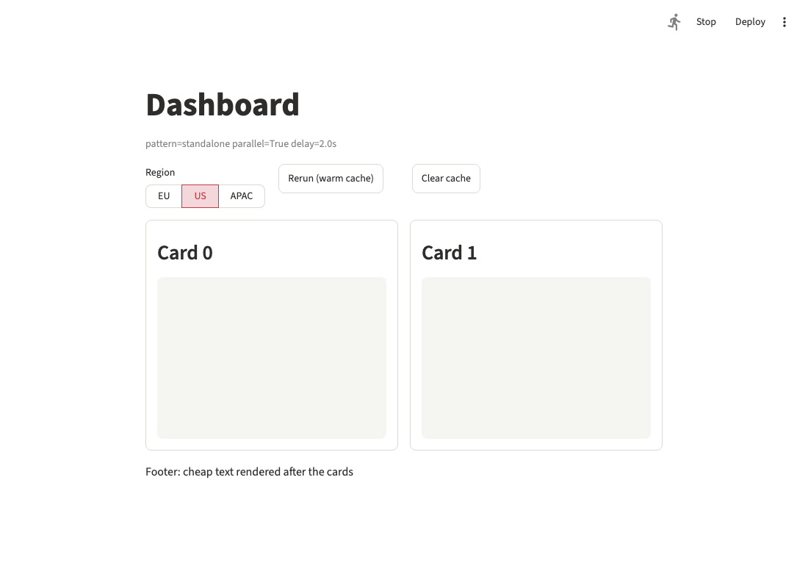

# Layout-first loading for dashboards

## Summary

Make the dashboard loading style "cheap layout first, skeletons hold the space, expensive
content fills in" work reliably with `st.skeleton` and `@st.fragment(parallel=True)`. One
rule drives it: a skeleton holds its slot until the first visible element is drawn there.
Spinners don't count, and content from a previous run stays mounted underneath and is only
covered if loading takes longer than a short grace period. On top of that rule:

- `with st.skeleton()` fills its own slot.
- Fragments get a built-in skeleton for every run.
- Parallel fragments start after the script's layout has been sent.
- Spinners inside a skeleton become its label instead of a second indicator.

Cached reruns then show no skeleton, no flicker, and no remount, while cache misses show
the skeleton in place of the old content at its exact size.

## Problem

### Use case

A dashboard is a grid of cards. Each card has a cheap header (title, help, filters) and one
expensive body (a chart, dataframe, or metric that needs a query). The desired loading
experience:

1. **Layout first.** Titles, text, card borders, and filters paint immediately, before any
   expensive work starts.
2. **Reserved space.** Every expensive body shows a skeleton at its final size from the
   first paint, so nothing shifts when content arrives.
3. **Expensive work last, in parallel.** Queries run concurrently (parallel fragments), and
   each card fills in independently.
4. **Cached reruns are invisible.** A rerun that hits `st.cache_data` updates in place: no
   skeleton flash, no remount, no lost state (dataframe scroll and selection, chart zoom).
5. **Reloads show the skeleton again.** A rerun that misses the cache (filter change, TTL
   expiry, cleared cache) shows the skeleton *instead of* the old content, at the same size.

The embedded `developing-with-streamlit` skill already recommends this style
(`references/dashboards.md`, the `dashboard-metrics` and `dashboard-compute` templates), and
#8032 asked for skeletons for the same reason. None of today's patterns delivers all five
goals.

### What happens today

We measured each documented pattern in a two-card repro dashboard with a 2-second cached
loader, sampling the DOM every 40ms (method and raw numbers in the
[tech spec](./tech-spec.md#measurements)).

| Pattern                                                      | First load                                                  | Cached rerun                                                         | Cache-miss rerun                                                                                   |
| ------------------------------------------------------------ | ----------------------------------------------------------- | -------------------------------------------------------------------- | -------------------------------------------------------------------------------------------------- |
| `with st.skeleton(): data = load(); st.chart(data)` (skill)  | Card shows only its title for 0.5s, then the skeleton pops in | ✅ No skeleton, chart kept                                           | ❌ Skeleton appears **above** the stale chart; card doubles in height for ~1.6s                     |
| `slot = st.container()`; `with slot.skeleton(): ... slot.chart()` (skill) | Same as above                                               | ✅                                                                    | ❌ Same as above, plus ~70ms where the skeleton and the fresh chart are both shown                  |
| `ph = st.skeleton(); ph.chart(load())` (standalone)          | ✅ Skeleton immediately                                      | ❌ Skeleton flashes and the chart **remounts** when a hit takes more than a few ms (50ms tested) | ⚠️ Skeleton replaces the chart in place, but the chart remounts and loses its state               |
| Cached function with `show_spinner="..."` inside a skeleton  | Skeleton plus spinner                                       | ✅                                                                    | ❌ Skeleton and spinner stack above the stale metric; the spinner's gradient covers it (screenshot) |


Parallel fragments add two more problems:

- **The fragment's slot is empty until its worker runs.** A parallel fragment can't write to
  containers created outside it, so the skeleton has to live inside the fragment body. With
  `with st.skeleton()`, that body shows nothing for the first 0.5s, and fragments queued
  behind `runner.parallelMaxWorkers` (5–6 workers on 1–2 vCPU hosts) show nothing at all.
- **CPU-bound loaders slow down the layout.** Workers start as soon as the fragment is
  called and compete for the GIL with the thread that sends messages to the browser. With two
  CPU-bound loaders, the 40 cheap elements after the cards reached the browser after
  **~750ms**, while with I/O-bound loaders they were sent within ~15ms. The browser receives
  the cheap layout late, even though the script produced it in 10ms.

### Why

- `with st.skeleton()` is a *transient* anchored to its own (empty) slot, while the content
  is written to the *next* slot. Transients render before their anchor and never hide stale
  siblings, so the skeleton and the old content coexist.
- A standalone skeleton is an ordinary element at the content's slot. On every run, it
  replaces whatever is there, and an element-type change at a path remounts the React
  component. Whether the user sees it depends on whether the skeleton and the content
  happen to be sent in the same 5ms flush.
- The 0.5s grace delay is a backend `threading.Timer`. It can't reserve space on first load,
  and it fires late under CPU load.
- Nothing ties the cache spinner to the skeleton, so a cache miss adds a second loading
  indicator.

## Proposal

### 1. A skeleton holds its slot until the first visible element

Every skeleton, whether standalone, a `with` block, or fragment-level, follows one rule in
the frontend:

- **Visible content** is any element other than a skeleton or `st.empty`, or a container
  that holds one. Spinners and other transient elements are not visible content, so a
  cached function's spinner never ends a skeleton.
- **First load.** If the slot has nothing to keep, the skeleton renders immediately at its
  `height`.
- **Rerun.** If the slot holds content from a previous run, that content stays mounted.
  - Fresh visible content arriving within the grace period (0.5s, the same as the stale
    fade and `st.spinner`) replaces it in place, so the user never sees the skeleton.
    Content of the same type and identity keeps its React state.
  - After the grace period, a skeleton overlay covers the old content at its exact size
    until fresh visible content arrives.
- **Clearing.** The skeleton disappears as soon as the first fresh visible element lands in
  its slot. If none arrives, it depends on the kind of skeleton:
  - A standalone skeleton remains, as it does today.
  - A `with` block clears when it exits.
  - A fragment-level skeleton clears when the run ends.

This needs no API change, and it alone fixes the standalone pattern:

```python
chart_slot = st.skeleton(height=260)
chart_slot.bar_chart(load_revenue(region), height=260)
```

A prototype confirmed it: with 50ms of work on a cache hit, the overlay never became
visible, and the chart's and dataframe's DOM nodes survived both cached and cache-miss
reruns. On a miss, the overlay covered the old content after ~0.6s with no height change.



The alternative trigger is "until the block or fragment finishes". It hides partial content
and doesn't care what is drawn first, but it needs a completion signal from parallel
workers and hides streamed output. The first-element trigger is preferred.

### 2. `with st.skeleton()` fills its own slot

**Option A: Writes go into the skeleton's slot** ✅ PREFERRED

Elements written inside the `with` block go into the skeleton's slot, like `with
st.container()`. Under the rule, the skeleton holds the slot until the first element is
written. If the block exits without writing anything, the slot clears, as today. The
cached loader and the element it feeds live together, which is what users already write:

```python
with st.skeleton(height=260):
    data = load_revenue(region)
    st.bar_chart(data, height=260)  # Replaces the skeleton in its slot
```

- Pros: Fixes the screenshot bug and the 0.5s blank on first load. Content still appears
  as soon as it's written, so streaming works. Supports multi-element bodies.
- Cons: Behavior change. Elements land inside the slot instead of after it, at the same
  visual position. A cheap element written first, such as a caption, ends the skeleton
  early. Guidance: put the expensive element first, or keep cheap text outside the block.

**Option B: Keep writes in the parent, hide stale siblings**

The skeleton also hides any stale siblings that follow it until the block exits.

- Pros: No change to where elements are written.
- Cons: "Siblings that belong to the block" is ill-defined (conditional writes, columns,
  nested containers), and stale siblings that are not rewritten would disappear.

**Option C: Leave context-manager mode unchanged**

Recommend standalone mode (fixed by the rule) for dashboards.

- Pros: No behavior change.
- Cons: The idiomatic `with` pattern keeps the bug.

### 3. A skeleton for fragments

**Option A: Fragment-level skeleton** ✅ PREFERRED

The fragment's container shows a skeleton on every run of the fragment, under the rule
above. That includes full-app runs, fragment-only reruns (for example an in-card toggle),
and `run_every` refreshes.

For parallel fragments, the main script writes the skeleton into the fragment's
pre-allocated container when it dispatches the fragment. It shows from the first paint,
even when the worker is queued or deferred (change 4).

```python
@st.fragment(parallel=True, loading="skeleton")
def revenue_body(region):
    st.bar_chart(load_revenue(region), height=260)  # First visible element ends the skeleton


with st.container(border=True):
    st.subheader("Revenue by region")  # Cheap: drawn by the main script
    revenue_body(region)
```

- Pros: One place covers every run of the fragment. Needs no completion message from
  workers, because the frontend clears the skeleton on the first visible element.
  `@st.cache_data(show_spinner=...)` sets the precedent for loading UI on a decorator.
- Cons: Adds a parameter to `st.fragment`, and the size on a first load is unknown (see
  [Open decisions](#open-decisions)). A cheap element drawn first inside the fragment, such
  as its title, ends the skeleton early. The guidance is to keep card headers outside the
  fragment, which `st.card` does naturally (see [Interplay with `st.card`](#interplay-with-stcard)).

**Option B: Composition**

A parallel fragment called inside `with st.skeleton(height=260):` keeps the skeleton until
the fragment draws its first element. This falls out of change 2: the pending fragment
container is not visible content, so leaving the `with` block doesn't clear the skeleton.

- Pros: No new parameter. The size is given at the call site.
- Cons: Only covers full-app runs, because a fragment-only rerun doesn't re-enter the outer
  block. Covering reruns needs a second skeleton inside the fragment body.

**Option C: Let parallel fragments fill a placeholder created outside them**
(`ph = st.skeleton(); card(ph)`)

- Cons: Weakens the "no outside containers" rule that keeps parallel writes race-free.

### 4. Parallel fragments start after the layout is sent

**Option A: Default for full-app runs** ✅ PREFERRED

On a full-app run, parallel fragments are queued while the script body runs and start once
the body has finished and its messages have been flushed to the browser (bounded wait,
about 100ms at most). Fragment reruns and nested parallel fragments are unchanged. The
`parallel` docstring only promises that fragments *may* run concurrently with the rest of
the script, so this stays within the contract.

Prototype measurements with two CPU-bound loaders: the layout, footer, and both skeletons
reached the browser in **~100ms** instead of 750–850ms, and the cards finished 70–300ms
later than with an immediate start. For I/O-bound loaders the cost is the duration of the
script body after the dispatch, which is milliseconds in a layout-first script.

- Pros: Makes "layout first" hold regardless of GIL-heavy work. Simple mental model:
  "parallel fragments run after the script".
- Cons: Behavior change. Slow work placed in the main script *after* the fragment calls now
  delays the fragments instead of overlapping with them (mitigation: document "put slow
  work in fragments"). A variant starts workers at "body finished or N ms after dispatch,
  whichever comes first", which bounds that delay but weakens the guarantee.

**Option B: Opt-in**, via a config option such as `runner.parallelFragmentStart =
"after_script" | "immediate"` or a new `parallel` value

- Pros: No behavior change.
- Cons: The bad behavior stays the default, and users can't easily tell that their loaders
  are CPU-bound.

**Option C: No change**

Document the GIL caveat and recommend I/O-bound loaders in parallel fragments.

### 5. Spinners inside a skeleton

A cached function that misses, or an `st.spinner` block, inside a skeleton's slot currently
adds a second indicator. Here a "skeleton's slot" means the skeleton's `with` block, or the
container of a fragment that uses `loading="skeleton"`.

| Option                                                                      | Pros                                                     | Cons                                                                                                                     |
| --------------------------------------------------------------------------- | -------------------------------------------------------- | ------------------------------------------------------------------------------------------------------------------------ |
| A. Always hide the spinner                                                  | Simplest; one indicator                                  | Silently ignores an explicit `show_spinner="..."` or `st.spinner("...")`; long loads lose context                         |
| B. Show it as today; users pass `show_spinner=False`                        | No change                                                | Stacked indicators by default (screenshot); every dashboard must remember to opt out                                     |
| C. Render every spinner as a label on the skeleton                          | One indicator, no information lost                       | The auto-generated "Running `load_revenue(...)`." text is developer-facing noise                                         |
| **D. Hide auto-generated text, label the skeleton with explicit text** ✅    | Respects intent; no noise; one indicator                 | Two behaviors to document; needs skeleton labels (future work in the `st.skeleton` spec)                                 |

With option D:

- **Default `show_spinner=True`:** inside a skeleton's slot, nothing extra is shown. The
  skeleton is the loading indicator.
- **Explicit text** (`show_spinner="Fetching coverage..."` or `st.spinner("...")`): shown
  centered on the skeleton, with the spinner icon. It appears at the same time as the
  overlay and goes away with it.
- **Outside skeletons:** spinners are unchanged.

A standalone skeleton can't be tied to a spinner, because the spinner renders at the next
position in the parent. Guidance for that pattern stays `show_spinner=False`.

### Interplay with `st.card`

The [`st.card` proposal](https://github.com/streamlit/streamlit/blob/923a80f855791d3cb420589687d631c46e39e309/specs/2026-08-23-st-card/product-spec.md)
fits this loading model well:

- **The header is cheap by construction.** `label`, `caption`, `help`, and `icon` are card
  parameters drawn by the main script. The body can then be a fragment whose first element
  is the expensive one, which is exactly what the first-element rule needs.
- **The body has a known size.** `st.card(height=...)`, or `height="stretch"` in rows and
  `st.grid`, bounds the body. A fragment-level skeleton fills it on a first load without
  repeating sizes.

```python
@st.fragment(parallel=True, loading="skeleton")
def revenue_body(region):
    st.bar_chart(load_revenue(region), height="stretch")


for column, body in zip(st.columns(2), [revenue_body, orders_body]):
    with column:
        with st.card("Revenue", help="Last 30 days", height=340):
            body(region)
```

Required alignment with the card spec: it omits a body to which no elements are added. A
body holding only a pending skeleton or fragment container must count as content.
Otherwise the card renders header-only first and grows when the body arrives.

The card's `icon="spinner"` could later show the body's loading state in the header. This
is not proposed here.

### Resulting behavior

| Situation                                 | Proposed behavior                                                                                         |
| ----------------------------------------- | --------------------------------------------------------------------------------------------------------- |
| First page load                           | Cheap layout and skeletons paint together; content replaces each skeleton in place                        |
| Rerun, cache hit                          | Content updates in place; no skeleton, no remount                                                         |
| Rerun, cache miss                         | Old content stays for 0.5s, then the skeleton covers it at its exact size until the first fresh element  |
| Fragment-only rerun                       | Same as a rerun, for fragment-level skeletons and skeletons inside the fragment                           |
| Block raises an exception                 | Skeleton clears, as it does today                                                                         |
| No visible element is ever drawn          | A standalone skeleton remains; a `with` block clears on exit; a fragment skeleton clears when the run ends |

Content that changes identity still remounts on a miss, for example a dataframe without a
`key`, whose identity includes its data. Guidance keeps recommending a `key` for stateful
elements.

## Alternatives considered

- **Cache-driven skeletons** (`@st.cache_data(show_skeleton=True)`, or an `is_cached()`
  probe so apps only render a skeleton on a miss): the grace period already gives
  "skeleton only when slow" for free, also for uncached slow work (APIs, LLMs). The cache
  call site doesn't know the slot or its size. For TTL expiry specifically,
  `refresh_mode="background"` already avoids the reload entirely.
- **Card-level loading** (`st.card(..., loading=...)`): discoverable for dashboards, but it
  ties loading UI to one visual container. The fragment-level option covers cards and
  every other container.
- **Element-level loading state** (for example `st.line_chart(None, loading=True)`): sizes
  each skeleton perfectly and never changes element type, but needs a parameter on every
  element and doesn't cover multi-element bodies.
- **Deferred values** (`st.line_chart(st.defer(load, region))`, computed after the script):
  hides execution order behind values and doesn't fit widgets that return values.
- **Async scripts or process-based workers:** remove the GIL contention at the root, but are
  far larger architectural changes. Free-threaded Python would make change 4 matter less,
  not obsolete it.

## Rollout

| Phase | Changes                                                                                  | Kind                                         |
| ----- | ---------------------------------------------------------------------------------------- | -------------------------------------------- |
| 1     | The rule (change 1), frontend-side grace delay, and change 5 for today's `with` mode     | Bug fix, no API change                       |
| 2     | Change 2 and the fragment-level skeleton (change 3)                                      | Behavior change and a new fragment parameter |
| 3     | Change 4                                                                                 | Behavior change of parallel fragment timing  |

Update the embedded skill with each phase. Today `references/best-practices.md`,
`references/performance.md`, `references/dashboards.md`, and the dashboard templates
recommend the context-manager patterns that show the cache-miss bug. After phase 1 they
should switch to standalone mode, and after phase 2 to fragment-level skeletons and `with`
blocks.

## Out of scope

- Batching several messages per websocket frame to cut GIL hand-offs while CPU-bound work
  runs. This speeds up message delivery for every app, not just dashboards; see the
  [tech spec](./tech-spec.md#follow-ups).
- Skeleton shapes, `lines`, and animation options (already listed as future work in the
  [`st.skeleton` spec](../2026-05-13-st-skeleton/product-spec.md)).

## Open decisions

1. Is the change 2 behavior change acceptable, or should context-manager mode stay as it is
   (option C)?
2. Fragment skeleton API: the name (`loading="skeleton"` is an enum that can grow, vs.
   `show_skeleton=True`), and its size on a first load. Options are an explicit height
   argument, the parent's bounded height (`st.card(height=...)`, `st.container(height=...)`),
   or a fixed default.
3. Should change 4 be the default (option A) or opt-in (option B)? Should it use the
   "or N ms" variant?
4. Spinner policy: option D, or the simpler option A?

## Checklist

| Item                       | ✅ or comment                                                                                                |
| -------------------------- | ------------------------------------------------------------------------------------------------------------ |
| Works on SiS, Cloud, etc?  | ✅ Frontend rendering and script-runner timing only; change 4 helps most on small hosts                       |
| No breaking API changes    | ⚠️ One new optional `st.fragment` parameter; changes 2 and 4 change documented behavior                      |
| No new dependencies        | ✅                                                                                                            |
| Metrics collected          | ✅ Existing `skeleton` and `fragment` metrics, plus the new fragment parameter                                |
| Any security/legal impact? | ✅ No                                                                                                         |
| Any docs changes needed?   | ✅ `st.skeleton`, `st.fragment`, `st.cache_data`, and `st.spinner` docstrings, the loading-patterns guide, and embedded skill guidance and templates |
