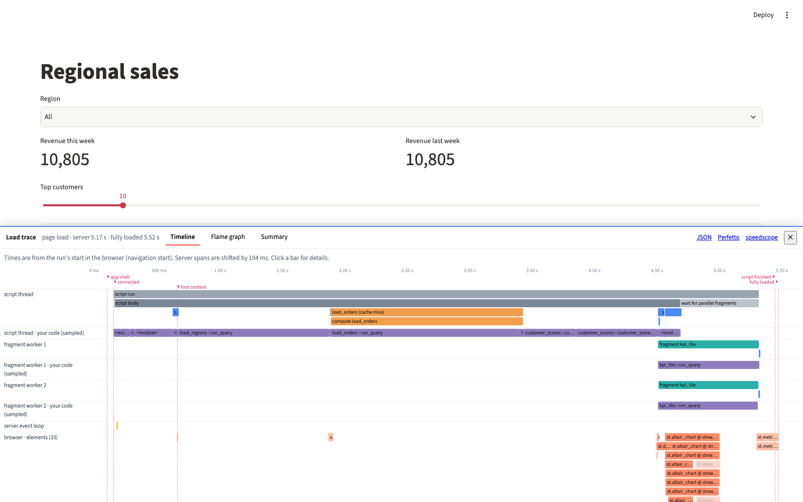
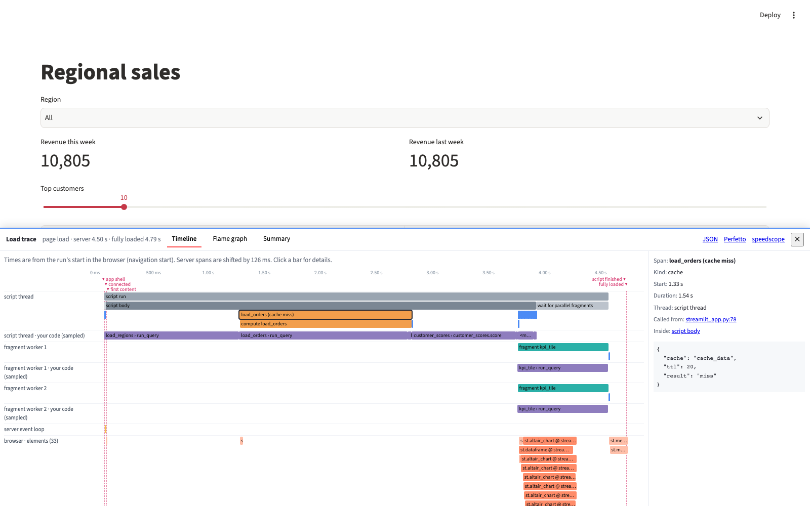
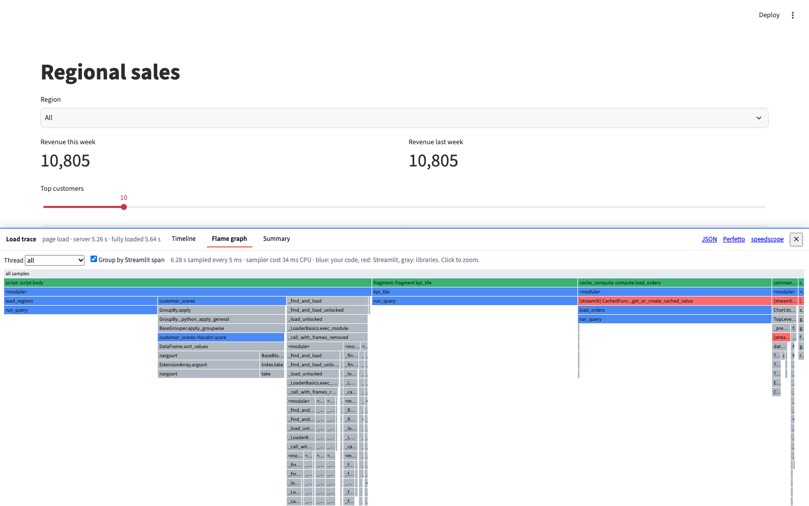

# Developer load trace

## Summary

A developer can record a trace of one page load or rerun and see where the time went: the
script, each `st.*` command, cached calls with hits and misses, fragments, callbacks,
sampled Python stacks of their own code, and when each element finished rendering in the
browser. The trace opens in the app, and it's also written as JSON plus a Markdown summary
that a coding agent can read. Tracing is off for viewers, and apps pay nothing for it until
a developer records a trace.



The screenshots in this spec come from a throwaway prototype running a synthetic demo app.

## Problem

"Which part of my app is slow?" has no built-in answer. It's one of the oldest open
requests:

- [#373](https://github.com/streamlit/streamlit/issues/373) "Implement an easy to use
  profiler" (2019, 39 reactions) asks for exactly this.
- [#16730](https://github.com/streamlit/streamlit/issues/16730) asks for a developer debug
  pane covering state, cache, memory and profiling.
- [#13992](https://github.com/streamlit/streamlit/issues/13992),
  [#14558](https://github.com/streamlit/streamlit/issues/14558) and
  [#4407](https://github.com/streamlit/streamlit/issues/4407) ask to see what the cache is
  doing: hits, misses, size and timing.
- [#9159](https://github.com/streamlit/streamlit/issues/9159) (18 reactions) asks for
  OpenTelemetry instrumentation, mostly to see per-run timing.
- [#9457](https://github.com/streamlit/streamlit/issues/9457) asks for Core Web Vitals,
  and [#12090](https://github.com/streamlit/streamlit/issues/12090) reports slow rendering
  of large pages with no way to see which elements are slow.

Today's workarounds each see one slice:

- Wrapping the script in `pyinstrument` or `cProfile`. The profile shows Streamlit
  internals rather than the app's commands
  ([#12103](https://github.com/streamlit/streamlit/issues/12103)).
- Sprinkling `time.time()` calls.
- Opening the browser's DevTools.

None of them connects server time to browser rendering, shows cache hits and misses, or
follows parallel fragments. None of them works in Streamlit in Snowflake (SiS), where the
developer has no terminal.

Coding agents do a growing share of performance work, and they guess when they can't
measure. A trace of one load would show most of the common causes of a slow app directly.
We reviewed the 30 internal apps with the most frustrated viewers, meaning viewers for
whom at least a quarter of first page loads took over 10 seconds. These 30 apps had 71% of
the frustrated viewers across 243 apps. The causes had to be found by reading query
history and code by hand, and could be explained for 21 of the 30. The most common were:

- slow query compilation (12 apps), which a trace shows only as a slow query
- cache TTLs shorter than the time between visits (11)
- work done one item at a time that could run in parallel (8)
- many small queries (7)
- Python, payload or rendering cost (4)
- tabs built on first load (3)

### Use cases

- A developer's page takes 6 seconds to load. The trace shows a cache miss on `load_orders`
  because its `ttl` is shorter than the time between visits, and an uncached query called
  on every run.
- A developer asks a coding agent to make the app faster. The agent records a trace,
  ranks the slow calls, changes the code, and records another trace to confirm.
- A dashboard's server work finishes in 1 second but the page feels slow. The trace shows
  the browser spends 2 more seconds drawing 24 charts, most of them below the fold.
- Once SiS can enable tracing for editors (open question 1), a developer in SiS records a
  trace from the app editor and pastes the summary into a coding agent's chat.

## Proposal

### Who can trace

By default, only a developer on the same machine as the server can trace. The server
decides per session, when the session connects. The browser shows the controls only when
the server allows it, because browser flags like `client.toolbarMode` aren't a trust
boundary ($48).

A new config option, `server.allowLoadTrace`, sets which sessions may trace:

| Value | Who can trace | Use |
|---|---|---|
| `"local"` (default) | Sessions that connect from the same machine and weren't forwarded by a proxy | `streamlit run` on a laptop, a coding agent on the same machine |
| `"all"` | Every session | A trusted shared dev server or a dev container. Anyone who can open the app can trace it, and traces include file paths and function names |
| `"none"` | Nobody | Turn it off locally |

```toml
# .streamlit/config.toml on a shared dev server
[server]
allowLoadTrace = "all"
```

The in-app entry point is a "Record load trace" item in the main menu's developer
options, so it's hidden wherever `client.toolbarMode` hides those options. The
`streamlit trace` CLI works regardless of `client.toolbarMode`.

**Options considered:**

**Option 1: Config option with a local-only default** ✅ PREFERRED

- Pros: Works with no setup locally, where most performance work happens. Off on every
  deployed server unless the operator opts in, and the opt-in value names who gets access
  ($48). Config is the right home for an environment policy ($38).
- Cons: "Local" is inferred from the connection, and a reverse proxy on the same machine
  can make a remote viewer look local. An `Origin` check catches those proxies (see the
  tech spec's "Per-session policy").

**Option 2: Reuse `global.developmentMode`**

- Pros: No new option.
- Cons: That option is for developing Streamlit itself; it changes asset serving and
  other behavior.

**Option 3: Follow `client.toolbarMode` or the host's `isOwner` flag**

- Pros: Already decides who sees developer options. `isOwner` is set by an embedding host
  over postMessage.
- Cons: Both are browser-side. A viewer could flip them and receive a trace.

**Option 4: CLI flag only (`streamlit run --trace`)**

- Pros: Explicit.
- Cons: A second spelling for a config value ($46), and agents would need to restart the
  app to trace it. Any config option can already be passed as `--server.allowLoadTrace`.

#### Tracing on SiS and Community Cloud

Tracing is unavailable on SiS and Community Cloud until the host can tell the server which
sessions belong to an editor (open question 1). The intended design:

- The host enables tracing only for editor sessions through a signal it sets on the server
  side, for example a header its proxy adds only for editors.
- The host's postMessage API, the channel that already sends `SET_IS_OWNER` (which tells
  Streamlit the viewer owns the app), only controls where the controls appear, for
  example in the editor's own UI.

### Recording a trace

A trace covers one run, from the trigger (navigation or the rerun request) until the page
is fully loaded in the browser: every visible element has finished rendering, or 30
seconds have passed. The trace panel offers three triggers:

| Trigger | What gets traced |
|---|---|
| Rerun and trace | A full rerun, started now |
| Trace next interaction | The next run started by an interaction in this tab: a widget change, a button, a page switch or a fragment rerun |
| Reload and trace | A page load: the browser reloads and traces the new session's first run, including connecting |

While a trigger is waiting, the panel shows "Recording the next run…", and the trace opens
when the run has fully loaded. "Show last trace" reopens the previous one.

From a terminal or an agent:

```bash
streamlit trace run --url http://localhost:8501            # trace one run, print the summary
streamlit trace run --url http://localhost:8501 --browser  # wait for a page reload, include browser timing
streamlit trace summary                                   # print the latest trace's summary
streamlit trace export --format perfetto                  # convert the latest trace
```

`streamlit trace run` without `--browser` uses the agent API (`server.enableAgentApi`) to
start a headless session, so it has server timing but no browser timing. With `--browser`,
it traces the next page load instead, so someone has to reload the page in a browser.

**One run per trace, not a recording session.** A run is the unit Streamlit developers
already think in, and one run fits in a summary an agent can read. A start/stop recording
that traces every run in between is future work. `streamlit trace run --runs N` records N
consecutive traces.

### What a trace shows

The trace opens in a panel at the bottom of the app, with a timeline, a flame graph, a
summary and a sortable span table.

#### Timeline

Browser and server work share one time axis, starting at navigation or at the rerun
request. Each bar is a span: one timed piece of work.

- **Server thread lanes.** Each server thread gets a lane with the run, the script body,
  `st.*` commands, cached calls, fragments and callbacks. Each cached call shows its
  result: hit, miss, stale (an expired value returned while it refreshes in the
  background), or waited on another thread's computation.
- **"Your code (sampled)" lanes.** Under each thread, this lane fills the gaps between
  spans from the sampled stacks. Each bar names the app's own function and the library it
  called, such as `customer_scores › score -> pandas: DataFrame.sort_values`.
- **Browser lane.** Each new or changed element, from registration to ready. Elements that
  were never visible are faded.
- **Milestones** on the axis: app shell ready, connected, first content, script finished
  and fully loaded. These are the same milestones Streamlit's page-profile usage telemetry
  records.

Clicking a bar shows its details: the call site with a link to the source line, its
attributes, and the browser elements a command created (or, for an element, the command
that created it).



#### Flame graph

The sampled stacks aggregated per thread, optionally grouped under the Streamlit span they
ran in. The app's code, Streamlit and libraries have distinct colors, and runs of
Streamlit-internal frames collapse into one frame.



#### Summary

The same Markdown the CLI prints and the trace file holds: the slowest Streamlit work by
call site, cached calls, fragments, the script thread in order, the hottest paths in the
app's own code, browser rendering, and the run's totals. A "Copy summary" button puts it
on the clipboard for pasting into an agent's chat.

#### Export

Downloads of the trace as JSON, Chrome trace format for
[Perfetto](https://ui.perfetto.dev), and [speedscope](https://www.speedscope.app) format.

### Behavior with reruns, fragments and pages

- **Callbacks** run before the script and appear as their own spans in the same trace.
- **Fragment reruns** are runs. A traced fragment rerun covers only that fragment.
  "Trace next interaction" isn't consumed by `run_every` timer reruns, which would
  otherwise use it up before the developer interacts.
- **Parallel fragments** in the traced run appear on their own thread lanes, and the time
  the script waits for them appears as a wait span.
- **Page switches** with `st.navigation` or `pages/` are runs of the new page.
  "Trace next interaction" followed by a page switch traces the new page's run.
- **`st.rerun()`.** A run that ends in `st.rerun()` and its follow-up runs are recorded in
  the same trace as consecutive runs (up to 5), because the viewer experiences them as one
  load.
- **Interrupted runs.** If a new rerun interrupts the traced run, the trace keeps what was
  recorded and is labeled "interrupted". The trigger then applies to the run that replaced
  it, so the developer still gets a complete trace.
- **Several tabs.** Each tab is its own session, and a trigger only traces its own tab.

### Agent access

Locally, an agent uses `streamlit trace run` and reads the result from a known place:
`.streamlit/traces/latest.md` and `latest.json` next to the app's main script. The agent API
can also request a trace as part of an interaction, so an agent driving the app gets the
summary back with the interaction's response.

In SiS, an agent can't reach the app's files, so there are two other paths:

- The developer copies the summary from the panel into the agent's chat. This works
  wherever tracing is allowed, from the first version.
- When Streamlit's planned OpenTelemetry export is configured, a traced run also exports
  its detailed spans. That export is a separate feature, not yet specified, that sends
  per-run timing to an observability backend, as
  [#9159](https://github.com/streamlit/streamlit/issues/9159) requests. In SiS, the spans
  land in the Snowflake account's event table, where an agent with access can query them.
  The tech spec's "Relation to the OTel per-run span" proposes how they nest.

### Skill guidance for coding agents

The `developing-with-streamlit` agent skill, which ships with Streamlit, should send agents
to a trace before they change code. The proposed text is a new first section in the
skill's `references/performance.md`. It follows the skill's authoring rules in
`lib/streamlit/.agents/skills/AGENTS.md`, such as adding no new reference page and no
version stamps:

```markdown
## Measure before you optimize

Record a load trace of the slow page before changing code, and another after.

- Locally: with the app running, run `streamlit trace run --url <app URL>`. It prints a
  summary. Add `--browser` and reload the page to include rendering time. The full trace
  is in `.streamlit/traces/latest.json` next to the app's main script.
- Elsewhere: ask the developer to use "Record load trace" in the app's main menu and paste
  the summary.

In the summary, start with the slowest spans and the hottest paths in the app's own code:

- A cache miss on every load usually means `ttl` is shorter than the time between visits.
- A slow call that isn't cached and returns the same result for every viewer belongs in
  `st.cache_data`.
- Wall time far above CPU time means waiting on I/O or a query. Run independent waits in
  parallel fragments or threads.
- Time after "script finished" is browser rendering. Render fewer or lighter elements, or
  move heavy content into tabs or expanders.
```

`SKILL.md` would add one line to its slow-app routing: "Measure with a load trace first;
see `references/performance.md`."

### Behavior contract

- **State.** A trace belongs to the session that recorded it and isn't stored in session
  state. Locally, the last 20 traces are kept as files.
- **Failures.** Tracing only observes. If recording, summarizing or writing a trace fails,
  the run continues unchanged, the panel says the trace failed, and the server logs a
  warning ($44). A trace cut short by a size limit or the 30-second timeout is labeled as
  such, never shown as complete ($43).
- **Accessibility.** The panel and its controls work with a keyboard and a screen reader.
  The timeline and flame graph are visual. The Summary tab and the span table carry the
  same information accessibly ($49).
- **Data exposure.** A trace contains code locations and timing, never values: no
  argument or return values, widget values or labels, cache keys or values, query text,
  or data ($48). It's sent only to the session that recorded it. The tech spec's
  "Security and privacy" section lists every field.
- **Cost.** With nothing recording, the server does one integer check per hook and the
  browser loads no trace code, because the panel is a lazily loaded chunk ($52). In the
  prototype, this was within noise. Recording slows a run by about 2% on a realistic demo
  app and by up to about 17% in a worst case of 600 commands and 300 cache hits (see the
  tech spec's "Overhead").
- **Compatibility.** Apps behave the same whether or not tracing is allowed. `AppTest`
  doesn't record traces. The agent API can request them. There's nothing to trace in a
  static export, which has no server. `st.App` under an external ASGI server gets the same
  behavior as `streamlit run`.

### Out of scope (future work)

- A recording session that traces every run between start and stop.
- Comparing two traces side by side.
- Memory and cache-size profiling ([#14558](https://github.com/streamlit/streamlit/issues/14558)).
- Snowflake query IDs and query-level detail in spans.
- Traces in `AppTest` (`at.run(trace=True)`).
- Always-on tracing of the last few runs.

### Open questions

1. **SiS and Community Cloud enablement.** What server-side signal can the host provide
   that a session belongs to an editor? Until there is one, tracing is unavailable there.
2. **Source links.** The prototype links call sites with `vscode://file/...`, which only
   helps VS Code and forks of it. Should there be a config option for the editor's link
   scheme, or just a "copy path:line" action? In SiS, the host could open the line in its
   own editor through postMessage.
3. **Agent API shape.** Should the agent API's interact request take a `trace` flag, or
   should agents always go through `streamlit trace run`?
4. **Event table export.** Should a traced run's detailed spans go to the OpenTelemetry
   export by default when it's configured, or only on request?

## Checklist

|                                          |                                                                                                                                                  |
|------------------------------------------|--------------------------------------------------------------------------------------------------------------------------------------------------|
| **Works on SiS, Cloud, etc?**            | Locally, and on any server with `allowLoadTrace = "all"`. SiS and Community Cloud need a host signal for editor sessions (open question 1).      |
| **No breaking API changes?**             | Yes. Adds a config option, a CLI group and an agent API option.                                                                                  |
| **No new dependencies?**                 | Yes. The sampler uses the standard library and the views need no new frontend packages.                                                         |
| **Metrics collected?**                   | Counts of traces recorded per trigger and of panel tabs opened. No trace content.                                                               |
| **Any security/legal impact?**           | Traces expose file paths and function names. They're limited to local sessions by default and sent only to the session that recorded them.      |
| **Any docs changes needed?**             | A docs page on profiling an app, the config option, the `streamlit trace` CLI reference, and the `developing-with-streamlit` skill text above.   |
